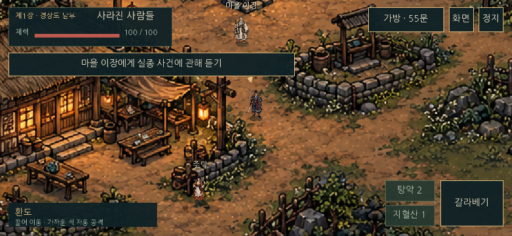
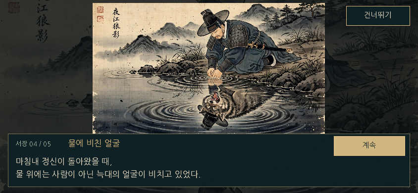

# 증강: 팔도야담 — C 게임과 브라우저 테스트

**C11 + SDL2로 만드는 픽셀 스토리 RPG 시제품입니다.** 전투·퀘스트·상점·대화·지형·화면 렌더링을 C로 구현했습니다. 같은 소스로 PC용 실행 파일과 브라우저 테스트용 WebAssembly를 빌드합니다. 브라우저의 HTML/JavaScript는 화면과 로더 역할만 맡습니다.

## 0.8.0 — 장비창 · 수동 공격 · 스와이프 무공

마을 배경 원화 리메이크 1차 후보(사용자 리뷰 대기): 기존 배치와 조선풍을 유지하며 배경 재질 묘사를 개선하고, 로딩 시 샤픈 처리를 제거했습니다. 생성 결과와 실행 이미지는 원본과 같은 1536×1024입니다. [전후 비교](docs/village-remake-pass1-comparison.png), [실제 게임 비교](docs/village-remake-pass1-gameplay.png), [검증과 남은 확인](docs/VILLAGE_REMAKE_PASS1.md)을 참고하세요. 충돌·가림·퀘스트·조작은 유지하며 병합·배포는 별도 승인 대기입니다.

- 가방 왼쪽에 캐릭터와 무기·투구·갑옷·신발·목걸이·반지 슬롯, 오른쪽에 장비·소비·기타·의뢰품 탭을 배치했습니다. 실제 보유 물품과 수량을 표시하고, 구입한 환도·갑옷을 장착/해제하면 전투 수치에 적용됩니다. 소모품을 사용해도 가방을 유지합니다.
- 근접 자동 공격을 수동 공격으로 바꿨습니다. 공격 버튼을 탭하거나 Z를 누르면 베고, 누르고 있으면 재사용 시간에 맞춰 반복합니다. 이동과 공격의 터치 손가락을 따로 추적합니다.
- 공격 버튼을 위/오른쪽/아래/왼쪽으로 밀면 갈라베기/횡베기/물러베기/파고들기가 발동합니다. PC에서는 Q/R/G/T입니다. K 또는 무공 버튼에서 방향을 고른 뒤 기술을 선택하면 배치가 서로 교환됩니다. 기본 배치 복원도 제공합니다.
- 네 기술 모두 0.64초의 준비·타격·회복 모션을 갖고 0.24초에 한 번 타격합니다. 횡베기는 넓은 검 궤적, 파고들기는 전진과 찌르기, 물러베기는 베고 후퇴하는 동작입니다. 이동과 공격에 지형·시야 판정을 적용합니다.
- 동작 마지막 0.22초에 넣은 다음 입력 한 개를 받아 이어 줍니다. 타격 후 1.05초 안에 서로 다른 동작을 잇으면 2연계 피해 +10%, 3연계 +20%로 이어집니다. 같은 동작 반복·시간 초과는 1연계로 돌아갑니다. 가방·대화·정지에서는 예약 입력을 지웁니다.
- 기술 모션은 기존 6프레임 공격 아틀라스에 기술별 타이밍·기울기·검 궤적·발걸음을 결합합니다. 장비별 외형 레이어 교체는 후속 작업입니다.

## 0.7.4 — 방향 수정 · 화면 비율 · 기본 공격

- 원화가 왼쪽을 향하는 기준에 맞춰 정지·걷기·공격의 좌우 반전을 수정했습니다.
- 월드 화면을 1.2배 확대했습니다. 주인공은 약 46 → 55px로 표시되며, NPC·적·건물·나무도 같은 비율로 커집니다. UI 크기는 유지합니다. 카메라 시야와 터치 목적지를 같은 좌표 변환으로 처리하므로 지형 충돌과 길찾기가 그림에 맞게 유지됩니다.
- 자동 기본 공격에 준비·내려베기·후속 동작·복귀의 6프레임 모션을 추가했습니다. 0.42초 동작 중 0.14초에 타격하며, 같은 공격에서 중복 피해가 발생하지 않습니다. 타격 시 거리와 벽을 다시 검사하고, 메뉴 중에는 공격 시간이 멈춥니다.
- 장비별 외형 변경을 위한 프레임 크기·발 기준점·좌우 방향 규칙은 [미술 기준](docs/ART_DIRECTION.md)에 기록했습니다. 장비별 외형 교체는 후속 작업입니다.

## 0.7.3 — 주인공 이동 모션

- 기존 주인공 디자인을 기준으로 발·무릎·옷자락이 움직이는 8프레임 걷기를 추가했습니다. 키보드, 터치 드래그, 목적지 이동이 같은 모션을 사용합니다.
- 실제 이동 거리에 맞춰 프레임이 바뀝니다. 느린 드래그에서는 발걸음도 느려지고, 벽에 막히거나 입력을 놓으면 기존의 정지 자세로 돌아옵니다. 좌우 방향 전환과 벽을 따라 미끄러지는 이동에도 연결됩니다.
- 정지 시의 기존 그림, 46×46 표시 상자와 발 기준점, 그림자·가림, 이동 속도·충돌·전투·NPC를 유지했습니다. 위아래 이동은 기존과 같은 시점의 걷기를 사용하며 별도 앞·뒤 원화는 아직 없습니다.
- 원본·제작 프롬프트·실행용 아틀라스와 [미술 기준](docs/ART_DIRECTION.md)을 보존했습니다. [실제 C 실행 화면의 모션 확대](docs/hero-walk-preview.gif)에서 확인할 수 있습니다.
- 이번 단계는 이동 모션입니다. 기본 공격 모션과 배경 개선은 각각 다음 진행 확인 후 작업합니다.

## 0.7.2 — 주인공 캐릭터 선명도 개선

- 주인공의 기존 얼굴·상투·남색과 청록 갑옷·금색 장식·붉은 허리띠·환도·서 있는 자세를 유지하면서 캐릭터 그림을 선명하게 다듬었습니다.
- 고해상도 제작 원본은 `art/hero/warrior-clarity-master.png`, 실행용 이미지는 `assets/warrior-v2.png`입니다. 실행용 이미지는 작은 크기에 맞춰 138×138로 미리 축소하고, 게임 안에서는 기존의 또렷한 픽셀 샘플링을 유지합니다.
- 게임 안 높이 46, 발 위치, 그림자·가림 영역, 이동·충돌·공격 판정은 유지합니다. 전령은 기존 `warrior.png`를 계속 사용합니다.
- 이번 단계는 정지 캐릭터 개선입니다. 이동 모션, 기본 공격 모션, 배경 개선은 각각 사용자 확인 후 진행합니다. 제작 기준과 원본 프롬프트는 [미술 기준](docs/ART_DIRECTION.md)에 기록했습니다.

## 0.7.1 — 드롭 타이밍과 작은 화면 수정

- 약재는 등장 후 0.7초 동안 바닥에 머물며 작게 튀어 오릅니다. 그다음 느리게 출발해 점점 빨라지는 속도로 끌려오고, 캐릭터 발밑에 떨어져도 바로 사라지지 않습니다.
- 서장·NPC 대화창 높이를 실제 줄바꿈 결과로 계산합니다. 432×270, 480×306처럼 짧고 좁은 가로 화면에서도 본문을 16px 이상으로 유지하며, 마지막 줄까지 상자 안에 표시합니다.
- 버튼의 보이는 크기·여백, HUD와 상점·가방의 크기를 줄였습니다. 주요 터치 영역은 유지하고 모든 버튼 글자와 본문 영역에 경계 처리를 추가했습니다.
- 확대율 1 / 1.25 / 2에서 텍스트가 지정 영역 밖에 그려지지 않는지 픽셀 검사하고, 모든 서장·NPC 대사의 높이를 검증합니다.

## 0.7 — 자동 회수와 모바일 UI

- **자석처럼 자동 회수:** 가까운 약재가 반경 156 안에서 캐릭터로 부드럽게 끌려와, 거리 16에 닿으면 획득됩니다. 이동을 멈추거나 줍기 버튼을 누를 필요가 없습니다. 벽 너머 회수·중복 획득을 차단하고 대화·메뉴 중에는 멈춥니다. PC의 기존 F 입력은 보조 조작으로 유지했습니다.
- **둥근 먹색 UI:** 버튼·대화창·상점·가방·증강 카드의 모서리를 둥글게 통일하고 테두리 대비를 낮췄습니다. 버튼 글자는 실제 글자 영역을 기준으로 가로·세로 중앙에 정렬합니다.
- **옛 책과 붓글씨 분위기:** 제목·인물 이름에는 나눔붓글씨, 버튼·대사·안내에는 나눔명조 Bold를 사용합니다. 폰트는 앱에 포함되므로 실행 중 외부 폰트 서버가 필요하지 않습니다.
- **작은 가로 화면:** 568×320부터 확인했습니다. 터치 버튼 간격과 크기를 정리하고, 좁은 증강 카드는 핵심 효과만 간결하게 보여 줍니다. 웹 화면은 기기의 안전 영역 여백을 반영합니다.
- **Space 대화 / 다음, Q 스킬 유지.** 터치 후에는 버튼의 PC 단축키 힌트가 숨겨집니다. 퀘스트 안내는 화면 가장자리의 작은 패널과 한 줄 알림을 유지합니다.
- **4번의 새 조작 실험은 사용자 요청으로 보류합니다.** [조작 기록](docs/CONTROLS.md)의 제안은 구현하지 않았습니다.

## 0.5 — 어디서든 브라우저로 테스트

- 회사 PC에 CMake·SDL2·VS Code 확장을 설치하지 않고 브라우저에서 플레이할 수 있습니다.
- `src/`의 C 코드를 GitHub에서 수정하고 커밋하면 `.github/workflows/web.yml`이 자동으로 웹 버전을 빌드합니다.
- 고정 게임 주소를 쓰려면 저장소 **Settings → Pages → Source: GitHub Actions**를 한 번 설정한 뒤 Actions의 **Build and publish browser game → Run workflow**를 실행합니다.
- Pages를 아직 설정하지 않았어도 빌드는 성공하며, 해당 실행의 **Artifacts → paldo-browser**에서 결과를 내려받을 수 있습니다.
- `offline/index.html`은 코드와 그림·폰트를 모두 포함합니다. 압축을 푼 뒤 브라우저로 열 수 있습니다. 회사 정책에서 로컬 HTML이나 WebAssembly 실행을 허용해야 합니다.
- 가로 화면, 한글 컷신, 키보드·마우스·터치 입력, 화면 위 대화창, 지형 충돌을 공통 C 코드로 실행합니다.
- 새로고침·창 닫기 시 진행은 초기화됩니다. 영구 저장은 아직 없습니다.

처음 설정, 회사에서 수정하는 방법, 웹 빌드 명령은 **[브라우저 개발 안내](docs/WEB.md)**를 참고하세요.



## 0.4 — 프롤로그와 지형

사용자가 제공한 세 장을 귀향길 → 허기와 갈증 → 물에 비친 늑대 순서로 연결하고, 마지막에 10년 뒤 마을로 전환합니다. 원본 비율을 유지하고 그림 전체를 대화창 위에 표시합니다.



집·담장·울타리·우물·바위·숲에 충돌 영역을 추가했습니다. 발밑 기준으로 막히며 벽을 따라 이동합니다. 목적지를 탭하면 열린 길로 돌아갑니다. 적의 추격과 돌진 스킬에도 같은 지형 판정을 적용하고, 벽 너머 공격·상호작용을 차단합니다. 지붕과 나뭇가지 뒤에서는 캐릭터가 가려지고 플레이어의 위치는 희미하게 보입니다.

마을 입구, 상점, 흔적, 약재 회수 장소, 보스까지 이동 가능한지 자동 검사합니다. 충돌 좌표와 개발용 확인법은 [지형 안내](docs/TERRAIN.md)에 있습니다.

## 지금 플레이할 수 있는 내용

귀향길 프롤로그 → 마을 이장에게 의뢰 → 흔적 두 곳 조사 → 변이한 멧돼지 3마리 처치 → 약재 꾸러미 회수와 약방 전달 → 이장에게 보고 → 멧돼지 백정전 → 첫 증강 선택 → 윤겸의 서신.

- 대장간: 단련한 환도와 누비 갑옷. 구입 즉시 장착합니다.
- 약방: 탕약과 지혈산. 체력 회복·출혈 해제가 실제 전투에 적용됩니다.
- 주막: 국밥과 휴식으로 체력을 회복합니다.
- 가방·여정 기록·목적지 화살표·소지금·한글 대화·재도전이 포함됩니다.
- 하나의 비대칭 맵을 카메라로 이동합니다. 집·나무를 거울 반사하거나 반복하지 않습니다.
- 화면이 달라지면 시야가 달라집니다. 오브젝트 크기와 종횡비를 화면에 맞춰 늘리지 않습니다.
- 패배해도 같은 실행 중 조사·장비·물품 진행은 유지됩니다. **프로그램을 종료하거나 처음으로 돌아가면 새 여정이 시작됩니다. 영구 저장은 아직 없습니다.**

## Ubuntu / Linux에서 실행

Ubuntu 24.04 기준 설치 및 빌드:

```bash
sudo apt-get install build-essential cmake libsdl2-dev
cmake -S . -B build -DCMAKE_BUILD_TYPE=Release
cmake --build build --parallel
ctest --test-dir build --output-on-failure
./build/paldo-yadam
```

명령은 압축을 풀어 생기는 `paldo-yadam-c/` 폴더에서 실행합니다.

PNG·한글 폰트 로더는 포함되어 있습니다. SDL2_image, SDL2_ttf를 별도로 설치할 필요가 없습니다. 실행 파일 옆의 `assets/` 폴더가 필요하며, CMake 빌드가 자동으로 복사합니다. 다른 위치의 파일을 쓰려면 `./build/paldo-yadam --assets /absolute/path/assets`를 사용합니다.

## Windows / macOS

CMake와 C11 컴파일러, SDL2 개발 패키지를 설치한 뒤 같은 CMake 프로젝트를 빌드합니다.

- Windows: Visual Studio 2022의 C++ 데스크톱 개발 도구(C 컴파일러 포함)와 vcpkg의 `sdl2:x64-windows`를 사용할 수 있습니다. `-DCMAKE_TOOLCHAIN_FILE=<vcpkg>/scripts/buildsystems/vcpkg.cmake`를 지정하세요. 실행 위치에 `SDL2.dll`도 필요합니다.
- macOS: `brew install cmake sdl2` 후 위 CMake 명령을 사용합니다.

Linux와 Windows의 빌드·렌더링을 확인했습니다. macOS 실행은 아직 검증하지 않았습니다.

## Android

`android/`는 같은 C 게임을 Android NDK로 빌드하기 위한 프로젝트입니다. Java 파일 한 개는 SDL 앱 진입점이며 게임 로직은 모두 `src/*.c`에 있습니다.

```bash
python3 scripts/prepare_android.py
```

그다음 Android Studio에서 **`android/` 폴더**를 엽니다. 자세한 SDK·NDK 구성과 APK 생성 방법은 [Android 빌드 안내](docs/ANDROID.md)를 참고하세요.

**이번 작업에서는 Android SDK/NDK가 없어 APK 빌드·실기기 실행을 검증하지 못했습니다.** Android 프로젝트와 터치 입력은 포함되어 있으며, PC 실행 파일을 휴대폰에서 직접 실행할 수는 없습니다.

## 조작

| 동작 | 마우스·터치 | 키보드 |
| --- | --- | --- |
| 이동 | 화면을 끌거나 목적지 탭 | WASD / 방향키 |
| 기본 공격 | 공격 버튼 탭 / 길게 누르기 | Z / 길게 누르기 |
| 무공 | 공격 버튼 ↑ / → / ↓ / ← 밀기 | Q / R / G / T |
| 무공 배치 | 무공 버튼에서 방향·기술 선택 | K |
| 대화·조사·상점 | 가까이에서 상호작용 버튼 | Space / Enter / E |
| 아이템 줍기 | 가까이 가면 자동 흡수·획득 | 동일 / F 보조 입력 |
| 가방·장착·사용 | 가방 → 부위 / 탭 → 물품 선택 | I |
| 여정 기록 | 좌측 상단 퀘스트 | J |
| 탕약 / 지혈산 | 하단 빠른 사용 | 1 / 2 |
| 전체화면 | 화면 버튼 | F11 |
| 일시정지·메뉴 닫기 | 정지·닫기 버튼 | Escape |
| 대화 진행 | 계속·확인 버튼 | Space / Enter |

기록 창에서는 위·아래 버튼 또는 마우스 휠로 목록을 이동합니다. 세로 화면에서는 회전 안내를 띄우고 진행을 멈춥니다.

## 소스 구조

| 파일 | 역할 |
| --- | --- |
| `src/game.h`, `src/game.c` | SDL에 의존하지 않는 게임 상태·전투·퀘스트·상점 |
| `src/draw.h`, `src/draw.c` | 이미지·한글 폰트·카메라·가림 효과·컷신 렌더링 |
| `src/world.h`, `src/world.c` | 지형 다각형·발밑 충돌·길찾기·공격 시야 판정 |
| `src/main.c` | 창, 터치·키보드, 대화, 메뉴, PC/브라우저 공통 프레임 |
| `tests/test_game.c`, `tests/test_world.c` | 퀘스트·거래·전투·이동·충돌·증강 검증 |
| `assets/` | 기존 PNG 그래픽과 한글 폰트 |
| `android/` | Gradle·NDK·SDL 앱 진입점 |
| `scripts/prepare_android.py` | 공식 SDL 소스 준비 및 체크섬 확인 |
| `scripts/build_web.py`, `web/shell.html` | Emscripten 빌드와 브라우저 로더 |
| `.github/workflows/web.yml` | C 검사, 웹 자동 빌드, Pages가 설정된 경우 배포 |

로직만 검사할 때는 SDL 설치 없이 빌드할 수 있습니다.

```bash
cmake -S . -B build-core -DPALDO_BUILD_GAME=OFF
cmake --build build-core
ctest --test-dir build-core --output-on-failure
```

실제 C 렌더러를 디스플레이 없이 점검할 수도 있습니다.

```bash
./build/paldo-yadam --smoke frame.bmp --scene shop --size 844x390
```

장면: `title`, `village`, `shop`, `bag`, `dialogue`, `journal`, `augment`, `boss`, `recover`, `prologue1`~`prologue5`, `roof`, `canopy`, `collision`, `loot`, `notification`, `npc`, `attack1`~`attack6`, `skill1`~`skill4`, `techniques`, `bag-consumables`, `bag-quest`. 이 옵션은 테스트용으로 상태를 준비하고 화면을 저장한 뒤 종료합니다.

## 확인된 범위

- GNU C 13 / C11, SDL 2.30 런타임으로 네이티브 게임 컴파일 및 CMake 빌드.
- 246개 조건 검사: 기존 게임 흐름 110개 + 지형·진입로·퀘스트 장소 왕복·돌진·벽 너머 공격·적 우회 이동 136개.
- 640×360 및 844×390 프롤로그 화면과 지붕·나뭇가지 가림 렌더링 확인.
- 실제 SDL 소프트웨어 렌더러로 마을·보스·상점·가방·대화·여정·증강·타이틀 화면 생성.
- 한글 폰트와 PNG 그래픽이 외부 네트워크 없이 로드됨.

첫 장의 시제품입니다. 팔도 전체, 백랑·신악의 뱀 전투, 전설 무기, 상하 방향별 별도 걷기 원화, 영구 저장은 다음 단계입니다. 0.4에서는 프롤로그 연출과 지형 이동을 보완했습니다.

라이브러리와 폰트의 출처·라이선스는 [THIRD_PARTY_NOTICES.md](THIRD_PARTY_NOTICES.md)에 기록했습니다.
