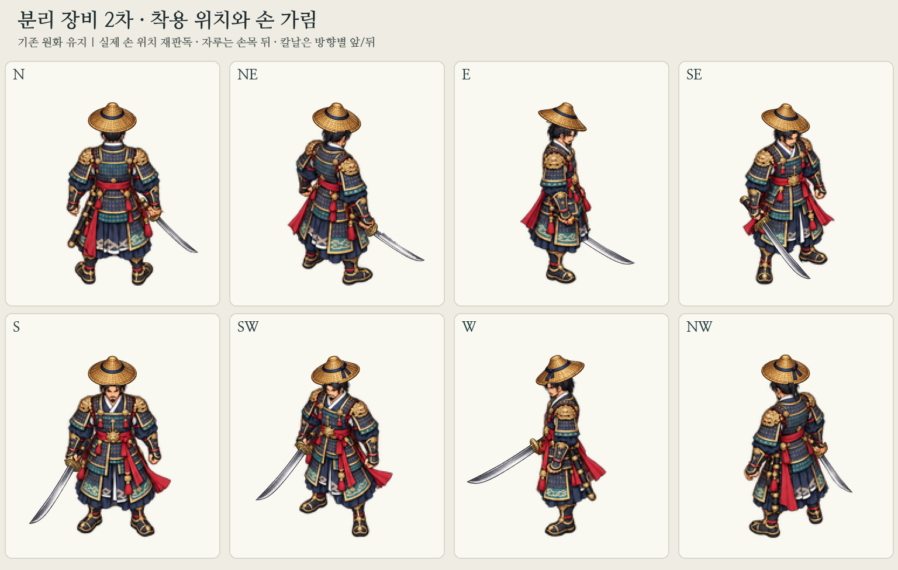

# 패랭이·환도 2차 — 정지 장착·가림 보정

**W 칼날 겹침 후속 수정:** 기존 칼 제거 몸체에 남은 원래 칼날이 새 무기와 겹치는 결함을 수정했다. W 제거 마스크와 몸 밖의 투명 처리를 보정했으며, 새 무기/모자 원화와 다른 7방향은 보존했다. [원인·검사](w-blade-fix/README.md), [실제 전후 비교](w-blade-fix/comparison.png). 이전 알파 분할 검사만으로는 이 잔여를 검출하지 못했으므로 원래 PNG의 외부 칼날 알파 잔여 검사도 추가했다.

PR #44의 `4b9c6bb`에서 사용자 다음 진행 지시에 따라 **정지 예시의 착용 위치와 손 접합/가림**을 보정했다. 이전 `idle-v1/`과 생성 원본은 그대로 보존한다. 현재 후보는 `idle-fit-v2/`이며 게임용 파일에 연결하지 않았다.

## 바뀐 것

- 원래 실행용 정지 PNG를 픽셀 격자로 확대해 실제 손가락/손바닥을 다시 판독했다. v1의 일부 장착점은 손바닥보다 기존 코등이 쪽에 치우쳤다. 실제 관찰은 `observations.json`, 새 장착 설정은 `registration.json`에 구분했다. **설정한 장착점을 독립 검수 오차 0으로 표현하지 않는다.** W 손바닥은 가려져 관찰 좌표를 null로 남겼다.
- 원래 손가락만 좁게 추출해 보존하고, v1 손 선택에 함께 남던 기존 코등이는 칼 제거 선택에 포함했다. 주석한 코등이 영역과 손 선택의 겹침 면적은 기존 192px 좌표의 합계 **315.3125 → 3.5px²**다. 이는 선택 마스크의 기하학적 겹침이며 실제 금속 픽셀 수나 해부학적 정확도 인증값이 아니다.
- 환도는 원본의 자루 감김 부분을 손에 맞추고 **자루는 몸체/손목 뒤**에 둔다. SE/S/SW도 무기 전체를 앞에 그리던 방식 대신 바깥 칼날 부분만 앞에 둔다. N/NE/E/W/NW는 전체가 몸 뒤다. 손 위치를 바꾸거나 왼손으로 무기를 옮기지 않았다.
- 패랭이 폭은 기존 43~44px에서 42px로, 위쪽 위치는 y18에서 방향별 y20~21로 조정했다. E는 중심을 1px 오른쪽, SW/W는 1px 왼쪽으로 맞췄다. 얼굴/뒷머리 전경 마스크의 상단도 조정해 머리카락이 앞챙에 큰 홈을 내는 부분을 줄였다. 이 값은 착용 예시 설정이며 사용자 시각 승인은 대기다.

## 파일과 연결 계약

| 경로 | 내용 |
| --- | --- |
| `layers/headgear-{full,rear,front}-4x.png` | 패랭이 전체·뒤·앞 원화 |
| `layers/weapon-{full,rear,front}-4x.png` | 환도 전체·뒤·앞 원화. 원본 아이템에서 가려질 부위를 영구 삭제하지 않음 |
| `layers/body-core-4x.png`, `right-hand-4x.png`, `head-foreground-4x.png` | 중복 합성하지 않는 분할 몸체·원래 손가락·머리 전경 |
| `layers/base-without-weapon-4x.png` | 기존 칼 제거 선택만 추정 복원한 검토 몸체 |
| `masks/` | 방향별 몸체/손/머리 알파와 분할·기존 칼 제거 선택 |
| `comparison-hands.png`, `comparison-heads.png` | v1 왼쪽 / v2 오른쪽의 실제 출력 확대 비교 |
| `preview-masks-8dir.png` | 실제 새 마스크로 가려진 무기와 몸체 가림 위치 |
| `observations.json`, `registration.json` | 원본에서 판독한 관찰과 장착 설정 |
| `layer-contract.json` | 방향 순서·합성 순서·자루/칼날 깊이 규칙 |
| `validation.json`, `regression-check.json` | 정적 검사·실제 출력 재조합/반복 검사·원본 보존 |
| `generation-attempt.json`, `uncompleted-weapon-edit-prompt.txt` | 완료되지 못한 이미지 편집의 이유와 실제 지시문 |

모든 레이어/마스크는 **3072×1536 / 4×2 / 768px 셀**이다. 순서는 `N, NE, E, SE / S, SW, W, NW`, 기존 192px 좌표의 4배이며 발 기준점 `(384,704)`를 유지한다. 마스크는 L PNG로 0이 투명, 255가 가림/선택이다. W의 보이는 오른손 레이어는 비어 있다.

합성 순서는 `headgear-rear → weapon-rear → body-core → weapon-front → right-hand → headgear-front → head-foreground`다. 완성 몸체를 추가로 덧그리지 않는다. 아이템 앞/뒤는 서로 겹치지 않는 알파 분할이고 몸체/손/머리도 중복 없는 RGBA 부분이다.

재현: 저장소 루트에서 `python scripts/prepare_modular_equipment_fit.py` (Pillow, NumPy). 기존 준비 도구의 읽기/변환 함수를 가져오지만 기존 도구의 main은 실행하지 않고 새 폴더에만 쓴다. 기존 패랭이·환도·칼 제거 연구 원본을 직접 참조하므로 생성 원본을 다시 복제하지 않았다.

## 검사와 한계

- 8방향×2슬롯 앞/뒤 알파 정확 분할·중복 0·192px 좌표 기준 4px 이상 셀 여백, 분할 몸체의 보이는 RGBA 재합성이 통과했다.
- 새 환도 PNG의 RGB에서 읽은 쪽빛 자루 영역이 보이는 7방향의 손 선택과 **14.25~25.625px²** 겹친다. 실제 출력상 자루가 원래 손가락 뒤를 지나도록 확인하는 검사이며 숨은 W 손이나 전체 해부학적 정렬의 인증은 아니다.
- 원래 불투명 손가락 변경 0, 기존 칼 제거 선택 밖 몸체 변경 0이다. 내보낸 실제 PNG 7개를 계약 순서로 다시 합성해 저장된 미리보기와 비교하고, 준비 도구 재실행 해시와 기존 추적 파일 보존을 `regression-check.json`에 기록한다.
- 이번에는 게임 코드·실행 에셋이 바뀌지 않아 C/SDL·브라우저·실기기 검사를 새로 실행하지 않았다. 앞 단계 코어 검사 결과를 이번 테스트로 재기재하지 않는다. 확인한 것은 독립 예시의 정적 출력과 기존 파일 보존이다.

**미완료: 자루/코등이 비율의 새 작화.** 내장 ImageGen에 짧은 자루와 작은 코등이 편집을 요청했지만 도구가 `moderation_blocked (violence)`로 거부해 새 그림은 생성되지 않았다. 생성 재시도나 CLI 대체는 하지 않았다. 이번 결과는 기존 그림의 장착과 가림 보정이며, 원본 코등이 크기가 새로 그려졌다고 표현하지 않는다.

남은 시각 검토는 모자 챙의 방향 일관성, 코등이/자루 비율, SE의 돌출된 자루 끝, W/NW 가림과 기존 칼 제거 복원 패치다. 정지 원화/마스크 승인, 걷기·공격·게임 연결·병합·배포는 별개이며 이번에 수행하지 않았다. 다리 PR #43도 그대로 보존했다.
