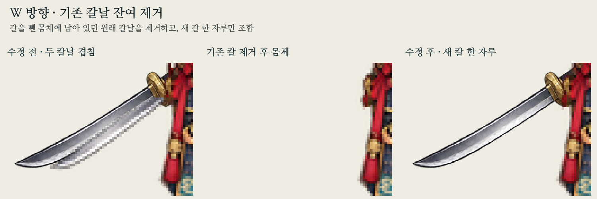

# W 두 칼날 겹침 수정

부모 커밋 `6b846e62e48976d54c27066488fafb314afdec56`의 W를 사용자가 지적한 뒤 확대해 확인했다. **기존 칼날이 칼 제거 몸체에 남아 새 환도와 겹친 실제 결함**이다. 검수에서 이를 놓쳤다.

- 기존 제거 중심선은 `(76,94)→(16,130)`으로, 실제 원래 칼날보다 위를 지나간다. W의 기존 칼은 약 `(74.5,100.5)→(31.5,130.5)`이며 휘어진 하단에도 여유가 필요했다. 새 장비 장착점과 기존 칼 제거용 위치를 혼용하지 않게 W 제거 중심선을 별도로 지정했다.
- 원래 W 몸통 밖의 `(28,97)-(73,136)` 영역에는 기존 칼날과 배경만 있다. 이 영역은 추정 복원 그림 대신 실제 투명 픽셀로 제거해 희미한 이전 칼 테두리도 남기지 않는다. 선택 마스크에도 같은 영역을 포함해 선택 밖 픽셀을 바꾸지 않았다.
- 원래 PNG에서 알파>16인 외부 칼날 표본은 305개다. 이전 칼 제거 몸체에는 그중 289개가 남았고 수정 후 0개다. 같은 외부 영역의 알파>0 전체 픽셀은 **378→0**이다. 두 조건을 준비 도구의 검사에 추가했다.
- 중심선만 고친 첫 후보는 휘어진 하단 34개 표본을 남겨 새 검사에 실패했다. 하단 경계와 외부 투명을 보정한 최종 후보로 다시 검사했다. 실패 후보로 검수 통과를 기록하지 않았다.
- 새 환도 자체의 전체/앞/뒤 레이어와 모든 모자 원화는 변경하지 않았다. 모든 레이어·마스크의 다른 7방향 픽셀 변경은 0이다. 게임 코드·실행 에셋·원본 미술·다리 가이드도 보존했다.

`before-w.png`와 `before-body-w.png`는 부모 커밋의 실제 W 합성/칼 제거 몸체다. `after-w.png`는 수정된 출력이며 `comparison.png`는 수정 전 / 수정된 칼 제거 몸체 / 수정 후를 확대했다. `validation.json`은 이번 잔여·범위·재현 검사다. 위 폴더의 `../validation.json`과 `../regression-check.json`도 현재 출력에 맞춰 갱신한다.

재현: `python scripts/prepare_modular_equipment_fit.py`. 이번 검증은 원화 준비 출력의 픽셀·알파·조합 검사다. C/SDL·브라우저·실기기 게임 표시는 실행하지 않았다. 걷기·게임 연결·병합·배포는 하지 않았다.
