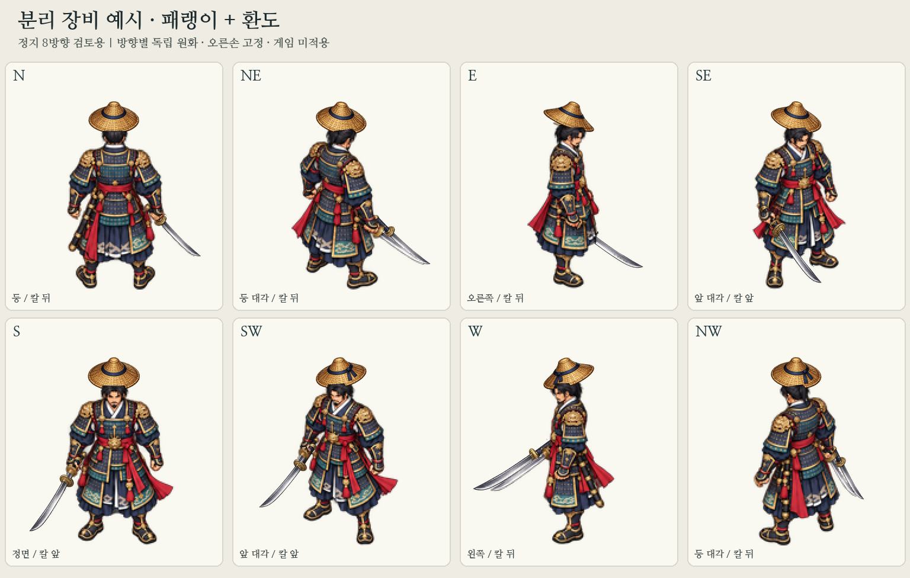

# 패랭이·환도 분리 장비 예시 — 정지 8방향, 미술 승인 대기

현재 main `04cb6c502b27b21777eeeca7dbac91c9feae1618`의 주인공에 머리 장비 **패랭이 1종**과 오른손 무기 **쪽빛 자루 환도 1종**을 조합하는 검토용 예시다. 기존 캐릭터의 성인 비율과 회화적 화풍을 따른다. 메이플식이라는 요청은 장비 슬롯별 원화를 분리해 조합하는 방식으로 적용했다. 다른 게임의 인물·비율·그림을 복제하지 않았다.

**원화와 마스크의 정적 검사는 통과했으나 착용감·재질·해부학적 정렬의 사용자 승인은 대기다. 게임 설치용 에셋이 아니며 코드 연결·걷기·공격·병합·배포는 하지 않았다.**

## 파일

| 파일 | 용도 |
| --- | --- |
| `paeraengi-generated-source.png`, `hwando-generated-source.png` | 내장 ImageGen으로 각각 제작한 독립 8방향 원화. 실제 1774×887 RGBA, 알파 0..255. 원본 그대로 보존 |
| `weapon-underpaint-generated-source.png` | 기존 칼 제거 부위만 복원하기 위한 생성 연구 원본. 전체 인물 대체 금지 |
| `*-prompt.txt` | 실제 사용한 세 개의 전체 지시문 |
| `reference-idle-8dir-2x.png` | 기존 실행용 정지 시트를 최근접 2배 확대한 생성 참조 |
| `layers/headgear-{full,rear,front}-4x.png` | 패랭이 단독 전체·뒤·앞 원화 |
| `layers/weapon-{full,rear,front}-4x.png` | 환도 단독 전체·뒤·앞 원화 |
| `layers/body-core-4x.png`, `right-hand-4x.png`, `head-foreground-4x.png` | 서로 겹치지 않는 몸체·오른손·얼굴/뒷머리 부분. 아래 순서대로 한 번씩 합성 |
| `layers/base-{original,without-weapon}-4x.png` | 기존 원본과 칼 제거 검토 몸체. 위 세 몸체 부분과 중복 그리지 않음 |
| `masks/*.png` | 방향별 머리·손·몸체 알파, 기존 칼 제거 선택, 앞/뒤 분할 선택 |
| `registration.json` | 방향별 직접 판독한 장착 위치·원본 선택 범위·환도의 균일 배율/회전. 수치 인증값이 아님 |
| `layer-contract.json` | 슬롯·그리기 순서·마스크 정의·후속 연결 범위 |
| `preview-parts-8dir.png`, `preview-masks-8dir.png`, `preview-se-breakdown.png` | 몸체 없는 장비, 가림 위치, SE 부위별 조합 설명 |
| `validation.json`, `regression-check.json` | 이번 정적 검사와 실제 실행한 회귀 검사/미검증 항목 |

모든 `layers/`와 `masks/` 시트는 **3072×1536**, 4×2, 셀 **768×768**다. 방향 순서는 `N, NE, E, SE / S, SW, W, NW`. 기존 192px 셀 좌표의 4배이며 발 기준점은 기존 `(96,176)` → `(384,704)`다. 새 슬롯 원화에는 몸체가 들어 있지 않다. 마스크는 L PNG로 0이 투명, 255가 가림/선택이다. 원화 분할 선택은 이진 값이고 몸체 가림은 원래 알파를 보존한다.

## 방향별 가림

| 방향 | 환도 깊이 | 손과 머리 처리 |
| --- | --- | --- |
| N | 몸체 뒤 | 화면 오른쪽의 해부학적 오른손이 자루를 덮음. 뒤통수/목덜미는 앞에 둠 |
| NE | 몸체 뒤 | 오른쪽 가까운 손·팔의 실제 실루엣으로 자루 접합을 가림 |
| E | 몸체 뒤 | 손·옆몸통이 자루를 덮고, 몸 밖으로 나온 칼날만 노출 |
| SE | 몸체 앞 | 칼날이 앞 옷자락을 지나며 오른손은 자루 위에 둠 |
| S | 몸체 앞 | 화면 왼쪽이 해부학적 오른손. 손이 자루를 덮음 |
| SW | 몸체 앞 | 앞 대각선의 오른손·옷자락 관계를 보존 |
| W | 몸체 뒤 | 오른팔이 먼 쪽이므로 몸통이 자루 일부를 가림. 칼을 빈 왼손으로 옮기지 않음 |
| NW | 몸체 뒤 | 먼 오른손/자루는 등·팔에 가리고 오른쪽 옆으로 칼날 노출 |

패랭이는 각 방향에서 **먼 챙 → 머리 → 앞쪽 왕골 몸체/가까운 챙 → 얼굴·뒷머리** 관계를 검토했다. 얼굴/목덜미와 오른손 경계는 원래 그림의 픽셀을 추출한다. 모자 매듭은 착용자의 왼쪽에 둔 설계다. 생성 결과의 세부 일관성과 실제 착용감은 시각 검토가 필요하다.

실제 합성 순서:

1. `headgear-rear`
2. `weapon-rear`
3. `body-core`
4. `weapon-front`
5. `right-hand`
6. `headgear-front`
7. `head-foreground`

몸체/손/머리를 서로 겹치지 않게 분할해 반투명 가장자리가 두 번 합성되는 문제를 방지했다. 위 레이어를 그린 다음 완성 몸체를 다시 덧그리지 않는다. 완전한 미가림 장비를 `full`에 보존하므로 가림을 장비 원본에 영구적으로 잘라 넣지 않았다.

## 준비 방식과 범위

`python scripts/prepare_modular_equipment_samples.py` (Pillow, NumPy)로 합성·분할·검사를 다시 만든다. ImageGen 생성 자체가 동일하게 재현된다는 뜻은 아니다.

- 생성 PNG를 보존하고 알파 1..4의 배경 잡점 및 주 원화와 떨어진 잡점을 준비본에서만 제외한다. 원래 선택된 픽셀의 색과 가장자리 알파는 유지한다.
- 원본의 실제 개체 범위를 선택한다. 특히 E 환도 끝이 명목상 세로 셀 경계를 넘으므로 단순 4×2 등분으로 칼끝을 자르지 않는다.
- 패랭이는 균일 배율로 머리 위치에 배치하고 환도는 직접 판독한 자루/칼끝을 기준으로 균일 배율·회전만 한다. 비균일 왜곡·수평 반전은 없다. 장착 좌표는 이 예시의 설정이며 독립 해부학적 정렬 검수값으로 보고하지 않는다.
- 기존 칼이 두 자루 겹치지 않게 검토 몸체를 만든다. 생성된 칼 제거 원본을 전체 시트 비율 그대로 축소하고, 좁은 `old-weapon-remove` 선택 안에서만 사용한다. 원래 손과 선택 밖의 모든 픽셀을 보존한다. SE 옷자락 등 칼 아래는 추정 복원이며 승인된 맨손 몸체가 아니다.
- `src/`, `assets/`, 다른 미술 원본·다리 가이드·다리 PR #43 브랜치는 수정하지 않는다. 기존 갑옷·장화·왼쪽 칼집·조작·판정·버전은 그대로다.

## 검사와 남은 문제

- 8방향×2슬롯의 앞/뒤 알파 합이 전체 알파와 같고, 앞/뒤 중복 알파는 0. 셀 여백은 기존 192px 좌표로 4px 이상이다.
- 8방향의 분할 몸체 재합성에서 보이는 RGBA가 일치한다. 불투명 원래 오른손 변경 0, 칼 제거 선택 밖 검토 몸체 변경 0이다.
- 두 번 실행한 준비 출력의 SHA-256과 기존 파일 보존은 `regression-check.json`에 기록한다.
- 이 환경에는 CMake가 없어 CTest는 실행하지 못했다. `cc -std=c11 -O1 -Wall -Wextra -Wpedantic`로 기존 게임/지형/수련/방향 전투/피드백 5개 검사 프로그램을 직접 컴파일·실행했다. **5/5, 총 3,361개 조건 통과**. CMake·SDL·브라우저·휴대폰 검증으로 표현하지 않는다.
- 남음: 모자 착용 높이·챙의 입체감, 자루와 손의 밀착, W/NW 가림 경계, 생성된 칼 제거 패치의 자연스러움과 아이템 디자인의 방향 일관성. 수치 검사만으로 원화/마스크 승인을 선언하지 않는다.

아까 다리 장비는 별도의 **PR #43 / `e078f0a`**에 있다. 최신 회화적 SE는 화풍 연구이며 정렬·접지 검수 미통과 상태다. 이번 예시는 그 다리 원화를 승인하거나 교체하지 않는다. 사용자 시각 확인 후 이 예시의 필요한 보정을 한 단계로 수행하며, 걷기·공격 원화/게임 연결은 이후 별도 승인 범위다.
