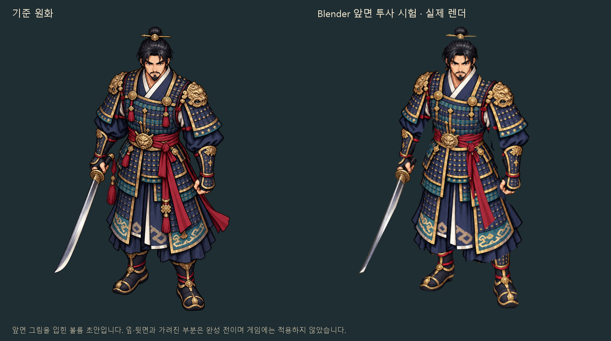
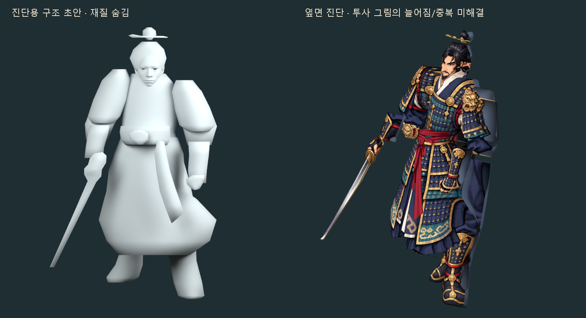
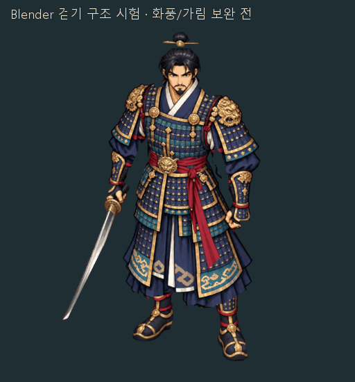

# Blender 장군 복장 첫 구조·화풍 시험

**상태: 사용자 미술 검토 불채택.** `cf548e6`의 보행/의상/무기 결과는 사용자가 원하는 사실적인 표현을 충족하지 않는다. 아래 구현·검사 통과 기록은 당시의 기술 결과이며 미술 승인이나 채택을 뜻하지 않는다. 기존 파일/영상은 실패 분석용으로 보존한다.

## 불채택 원인과 재작업 기준

- 사용자 지적: 실제 사람보다 과장된 만화 같은 움직임, 의상이 접히는 대신 몸과 함께 늘어났다 줄어드는 느낌, 칼을 포함한 전반적인 부자연스러움.
- 파일 확인: 옷자락은 288개 정점, 소매는 각각 128개 정점의 거친 볼륨이고 Armature 변형만 있다. 주름을 위한 별도 형상/천 변형이 없다. 표면에 그려진 갑옷판/주름/명암이 메시와 함께 늘어나므로 관절 추종을 추가해도 재료의 사실성이 생기지 않는다.
- 칼의 기하 길이를 곧바로 고무 변형으로 단정하지 않는다. 실제 평가 길이는 거의 일정하지만, 손과 검을 한 그림/얇은 외곽에 의존하고 있어 회전할 때 형태/명암/쥠이 부자연스럽다. 팔 궤적도 실제 보행 참고로 저작한 모션이 아니라 삼각함수 기반 합성이다.
- [실제 재열기 재료 변형 진단](../art/blender-hero-study/material-audit.json)은 1–25프레임의 49개 정수/중간 시점에서 실제 평가된 메시의 각 변 길이를 원래 길이와 비교한다. 국부 길이 변화이며 옷 전체 크기 변화율이나 주름 품질 점수가 아니다. 기존 보행/경계 검사에 없던 실패 원인을 확인하기 위한 진단이다.
- 측정 결과: 옷자락 국부 길이 비율 0.770–1.696(최대 약 69.6% 늘어남), 소매 약 0.859–1.143, 오른쪽 바지 0.494–1.623, 왼쪽 바지 0.381–1.585. 사용자가 지적한 고무 같은 늘어남이 실제 기하 변형에도 나타난다. 검은 0.999987–1.000013으로 길이를 사실상 유지하므로, 검의 문제는 형태/투사/쥠과 움직임을 따로 보완해야 한다. 이 진단 실행은 통과/승인 판정이 아니다.
- 재작업에서는 실제 몸과 의상을 기준으로 단단한 갑옷판/검과 천을 분리한다. 단단한 부분은 형태를 유지하면서 연결부에서 움직이고, 천은 소매/무릎/허리에서 국부적으로 접히도록 별도 형상이나 천 변형을 저작한다. 갑옷판 무늬를 부드러운 한 표면처럼 늘이지 않는다. 실제 보행 참고와 무게 이동을 먼저 확인하고 장비를 얹어 검토한다. 공식 개념 참고: [물체/뼈 부착](https://docs.blender.org/manual/en/5.0/scene_layout/object/editing/parent.html), [Armature 위의 천 예제](https://docs.blender.org/manual/en/latest/physics/cloth/examples.html). 이 문서에 그 기능의 구현 성공을 주장하지 않는다.
- 현재 투사 모델의 흔들림 값만 다시 바꾸는 작업은 해법으로 채택하지 않는다. 다음 제작은 먼저 모델/재질 구조와 한 동작의 미술 품질을 확인해야 하며, 이번 기록 단계에서 새 완성 모델을 만들지는 않았다. main 병합·배포 없음.

2026-10-22. 최신 main `04cb6c5`에서 독립한 `art/blender-hero-style-study-20261022` 작업이다. 사용자 승인 범위는 기존 성인 비율의 장군 복장으로 정지와 짧은 걷기를 시험해 보는 단계다. 게임 원화·실행 코드·판정·입력·NPC·퀘스트·맵을 교체하지 않는다. 장비 조합 PR #40은 별도 검토 상태로 보존한다.

## 결과와 판단

편집 가능한 [hero-front-study.blend](../art/blender-hero-study/hero-front-study.blend)를 만들었다. 실제 성인 인체 메시, 대략적인 입체 갑옷/옷자락/소매/신발, 오른손 검, 붉은 천 허리띠, 19개 뼈와 24프레임 걷기 구조 시험이 들어 있다. 텍스처 5개는 파일에 포함하고 경로를 상대화했다. Blender 4.5.14 LTS에서 생성·저장·재열기를 확인했다. 타임라인 1–24를 재생하면 걷기 시험이며 재생 범위 밖의 프레임 0을 정지 비교에 사용한다. 완성된 정지 애니메이션을 별도로 제작한 것은 아니다.

### 사용자 피드백에 따른 보행 수정

첫 시제품은 발 앞뒤 이동이 9cm, 오른손목 4.2cm에 그쳤고 팔과 다리의 반대 위상이 없었다. 소매가 윗팔 하나에 묶여 있고 무릎/발 연결에도 약 1.87cm 오차가 있었다. `64102cf` 상태의 저장 파일을 다시 평가해 확인한 값이다.

현재는 24fps/1초 주기에서 몸이 0.72m 전진한다. 두 다리는 반 주기 차이로 전진/지지를 교대하고, 같은 쪽 팔은 반대로 흔든다. 무릎은 모두 진행 방향으로 굽힌다. 골반의 작은 회전과 상체의 반대 회전을 더하고 몸의 수직 들썩임은 12mm에서 4mm로 줄였다. 지지 구간은 60%이며 발 관절의 월드 위치를 유지하고, 나머지 구간에 발을 앞으로 회수한다.

소매는 팔꿈치 부근에서 윗팔/아래팔에 분산하고 견갑 부분은 상체/윗팔을 함께 따른다. 바지 허리는 골반에 남고 아래쪽은 허벅지·정강이·발로 이어진다. 옷자락의 허리는 고정하고 아래쪽은 양 허벅지와 지연된 옷 뼈에 분산했다. 왼손은 별도 손목 메시로 옮기고 옷 외곽에서 손 그림 중복을 제외했다. 정지 원본 PNG는 수정하지 않았다. 이는 관절 스키닝 보정이며 물리 천·전신 충돌 시뮬레이션은 아니다.

**현재 방식은 기존 그림을 앞면에 투사한 볼륨 초안이다.** 앞면의 색과 장식을 유지하는 가능성은 확인했지만, 이를 완성된 3D 캐릭터나 8방향 양산 공정으로 해석하면 안 된다. 얼굴/갑옷의 고유 조형과 균일한 UV 텍스처를 완성한 상태가 아니다. 옆면에서는 그림이 늘어나고, 원화에서 팔이 가렸던 옷에 손 그림이 중복된다. 뒤쪽은 단색 임시 재질이며 그림의 알파 실루엣에도 의존한다. 밑단·소매·손잡이·옷의 가림과 동작 품질 역시 추가 작업이 필요하다.







[같은 보행의 실제 옆면 구조 영상](blender-walk-mechanics.gif): 원화 분위기와 별도로 팔·다리 교대/옷 변형을 확인하는 진단이다. 옷 아래에서 원래 숨긴 몸 면은 진단에서도 숨김을 유지한다.

따라서 이 단계에서 장비 수나 방향을 늘리지 않는다. 다음 독립 단계는 실제 갑옷의 앞·옆·뒤 조형, 팔에 가려진 면의 재질 복원, 손의 검 쥠과 옷자락 변형을 보완한 뒤 다시 비교하는 것이다. 앞면 유사성이 모든 방향의 화풍 유지나 제작 효율을 증명하지 않는다. 단순 도형/회전만으로 기존 원화 품질을 재현했다고 주장하지 않는다.

## 원본과 권리

- 기존 승인 원화 `art/hero/warrior-clarity-master.png`는 변경하지 않았다.
- 앞면 장비 텍스처는 PR #40 코드 커밋 `a435327`의 장군 상의/바지/띠/검 RGBA를 catalog 위치에 그대로 놓아 복원했다. 그림을 다시 생성하거나 확대·재도색하지 않았다. 크롭 원본/출력 SHA-256과 처리 내용은 [texture-provenance.json](../art/blender-hero-study/texture-provenance.json)에 보존한다. 이 Blender 단계의 미리보기는 이미지 생성 AI로 만든 모형 사진이 아니라 실제 Blender 출력이다.
- 인체 기준: Blender 공식 [Human Base Meshes](https://www.blender.org/download/demo-files/)의 CC0 `human-base-meshes-bundle-v1.2.0.zip`. 실제 사용한 메시 이름은 `GEO-body_male_realistic`와 양쪽 눈이다. 몸은 원화 자세에 맞춰 변형한 초안이며 얼굴을 주인공의 고유 조형으로 완성하지 않았다. [배포 목록](https://download.blender.org/demo/asset-bundles/human-base-meshes/). ZIP SHA-256 `b7421350cbad8425dd1ba93c4248867a1c236cc8a3a3dc140d4c2a03144c4bad`, 입력 .blend SHA-256은 `study.json`에 기록한다. 배포 파일 자체는 저장소에 재복사하지 않는다.
- Blender 공식 포터블 4.5.14 LTS를 작업 도구 폴더에 준비했다. [공식 배포와 체크섬](https://download.blender.org/release/Blender4.5/). ZIP SHA-256 `b9533d2397ac1984db4466fb23a7a4649391cca93f6e84209f9bcc60d071c8b9`가 공식 `.sha256`과 일치했다. 실행 프로그램/ZIP은 커밋하지 않는다. 라이선스 구매·유료 플러그인·외부 3D 생성 서비스는 사용하지 않았다.

## 재현·검증

Blender 배경 실행에서는 반드시 `--disable-autoexec --python-exit-code 1`을 사용한다. 시스템에 설치하거나 레지스트리를 변경할 필요 없이 공식 포터블로 실행했다.

```text
blender --background --factory-startup --disable-autoexec --python-exit-code 1 --python scripts/build_blender_hero_study.py -- --human-bundle /absolute/path/human_base_meshes_bundle.blend --no-render
blender --background --disable-autoexec art/blender-hero-study/hero-front-study.blend --python-exit-code 1 --python scripts/verify_blender_hero_study.py
blender --background --disable-autoexec art/blender-hero-study/hero-front-study.blend --python-exit-code 1 --python scripts/verify_blender_walk.py
blender --background --disable-autoexec art/blender-hero-study/hero-front-study.blend --python-exit-code 1 --python scripts/render_blender_hero_study.py
python scripts/preview_blender_hero_study.py
```

- 재열기 검사: 메시 21개, 뼈 19개, 포함 이미지 5개, 24프레임 동작, 양손 부위, 유한 좌표를 검사했다. 25개 시간 키의 양쪽 발 관절 목표 최대 오차 약 `9.54e-8 m`. 별도 보행 검사는 49개 정수/중간 프레임에서 실제 관절을 평가했다. 발 앞뒤 범위 45.0cm, 손목 26.3/38.3cm, 같은 쪽 팔·다리 상관 -0.947/-0.940, 관절 연결 최대 오차 약 0.00031mm, 지지발 관절 드리프트 약 0.304mm. 골반 기준 실제 변형된 소매/바지/옷자락의 움직임과 가중치 정규화도 검사한다. 이는 발바닥 전체/옷 충돌·자연스러운 보행의 미술 품질을 보증하지 않는다.
- 실제 저장 파일에서 CPU Cycles 12 samples로 정지/구조/옆면 768×768 RGBA 3장, 앞면 걷기와 옆면 구조 각 512×512 RGBA 24장을 출력했다. 빈 출력·4px 경계·프레임 중복·Blender File/Camera/Frame/RenderTime 정보 검사를 통과했다. 공개 PNG는 로컬 경로 메타데이터를 제외하고 동일 RGBA 픽셀로 저장한다. 원래 렌더는 무시되는 `build-blender-study/`에 보존한다.
- 두 GIF는 각각 24프레임 전부를 사용하는 1,000ms 리뷰다. 앞면 그림과 옆면 실제 구조를 나란히 검토할 수 있게 따로 제공한다. 본게임의 이동/공격/스킬 타이밍이 아니다. `study.json`, `validation.json`, `walk-validation.json`, `render-validation.json`에 구조·보행 검사·렌더 해시가 있다.
- 로컬 게임 CMake/CTest는 이번 원화 실험에서 새로 실행하지 않았다. `src/`, 본게임 `assets/`, 웹/Android 빌드와 워크플로를 변경하지 않았기 때문이다. 이전 작업의 테스트 숫자를 이번 결과로 쓰지 않는다.

초기 복구 기록: Blender 삼각 분할의 인덱스 반환 형식, 라이브러리 상대 경로 해석, 기존 인체 UV맵의 렌더 선택, 애니메이션 카메라의 옆면 위치 덮어쓰기, 저장 시 사용하지 않은 진단 재질 누락을 수정했다. 발 관절 재열기 검사에서 약 0.285m 오차를 검출해 시간 키 설정과 부모 관절 평가 순서를 바로잡았다. PNG에 Software 항목이 항상 있다고 가정했던 검사는 실제 Blender File/Camera/RenderTime 정보 검사로 교정했다. 보행 수정 중에는 중간 프레임의 지지발 오차 2.39mm를 검사에서 검출해 명시적 선형 보간으로 0.304mm로 줄였다. 옷에서 손을 없애기 위한 UV 압축은 무늬 늘어짐이 생겨 폐기하고 실제 옷 외곽을 조정했다. 이들을 수정한 뒤 재생성·재열기·실제 렌더와 경계 검사를 다시 통과했다. 옆면 검 끝 잘림도 카메라 범위를 넓히고 24장을 재출력해 해결했다.

현재는 미술 검토용 시제품이다. 완성 에셋 적용, main 병합, 자동 병합, Pages 배포, 버전 변경은 수행하지 않았다.
