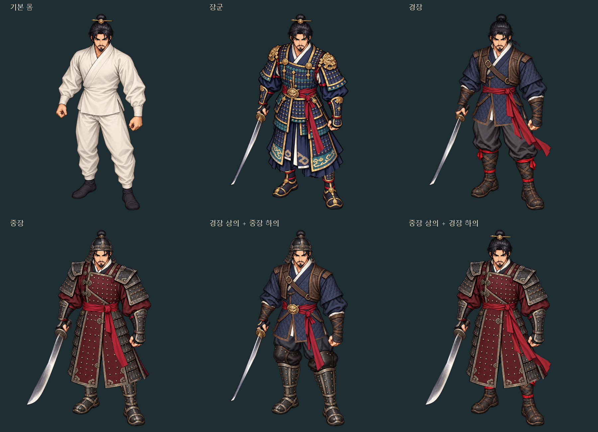

# 정지 장비 조합 개발자 모드

2026-10-22. 기준 main `04cb6c5`, 독립 브랜치 `graphics/equipment-layer-lab-20261022`.

## 열기

저장소에서 `python -m http.server 8766 --bind 127.0.0.1 --directory web/equipment-lab`을 실행하고 `http://127.0.0.1:8766/`을 연다. JavaScript 모듈과 PNG를 읽으므로 파일 더블클릭 대신 로컬 HTTP 서버를 사용한다. 일반 웹 빌드에는 별도 `equipment-lab/` 폴더로 복사된다. 게임의 시작 화면·훈련장·인벤토리에 진입 버튼을 추가하지 않았다. 사용자가 훈련장 연결 요청을 철회했다.

상의·하의·머리 장비·허리띠·무기를 독립 선택한다. 기본 몸/장군/경장/중장 프리셋, 무작위 조합, 기본 몸 숨김, 배경 3종, 투명 PNG 저장, 선택 JSON 저장/불러오기, 마지막 선택 기억 기능이 있다. JSON은 외형 ID만 저장하며 본게임의 장비 소유·능력치·세이브를 변경하지 않는다.

## 원화와 부위 계약

- 승인된 `art/hero/warrior-clarity-master.png`의 성인 비율·화풍을 따른다. PR #39의 경장/중장 원화와 프롬프트를 바이트 그대로 이 브랜치에 포함해 독립적으로 검토할 수 있다. 기존 원화는 교체하지 않았다.
- 내장 ImageGen으로 만든 새 원본은 `art/equipment-lab/`에 보존한다. 기본 몸 1장, 장비에 가려진 천을 복원한 상의용 원본 3장, 독립 바지·신발 원본 3장이다. 기존 경장/중장 참조 2장을 합해 이 폴더의 PNG 원본은 9장이다. 각 생성 프롬프트는 대응하는 `*-prompt.txt`에 보존한다.
- **상의에는 소매·갑옷·긴 옷자락 전체가 포함된다. 하의에는 바지·무릎/정강이 보호구·신발이 포함된다.** 초기 화면에서 상의를 허리선으로 잘라 자락을 하의에 넣었던 분류를 사용자 지적에 따라 폐기했다. 원본의 자연스러운 밑단과 앞트임을 따라 상의를 추출한다. 짧은 상의의 밑단보다 낮은 소매 끝도 별도로 보존한다.
- 긴 외투가 가린 바지 윗부분은 원화에 없으므로 단순 누끼로 복원할 수 없다. 같은 자세로 완전한 바지 원본을 별도로 제작해 모든 상의 아래에 입힌다. 하의 변경으로 상의 자락이 바뀌지 않는다.
- 흰 기본 옷은 장비로 교체되는 영역 전체를 알파로 가린다. 상·하의 장착 시 목 아래 기본 몸이 남지 않는 회귀 검사가 있다. 장비 자체의 흰 깃·소매 안감은 원화의 일부로 유지한다.
- 붉은 천 허리띠는 별도 아이템으로 유지한다. 과거의 느슨한 붉은색 추출에서 딸려 나온 갑옷 조각을 윤곽 제한·마스크 정리로 제거한다. 장군 허리띠는 금속 버클과 이어진 앞쪽 천을 사용하며 가려진 먼 뒤쪽 끝·별도 장식 술까지 완전히 복원한 아이템은 아니다.
- 검은 항상 이 자세의 해부학적 오른손에 들고 반전하지 않는다. 검 레이어의 잡는 손 패치와 무기 미착용 시 빈 손 패치가 손잡이와 손목을 연결한다. 혈흔은 추가하지 않는다.

`scripts/prepare_equipment_lab.py`가 실제 RGBA 원본에서 윤곽 선택·천 색상 마스크 정리·작은 조각 제거·연결 실루엣 선택·크롭만 수행한다. 원본 RGB를 다시 칠하거나, 비율을 늘리거나, 좌우 반전하거나, 팔을 회전하지 않는다. 상위 원본 자체는 위에 명시한 ImageGen 편집/생성 결과다.

모든 원본과 합성은 1254×1254 공통 캔버스를 사용한다. `web/equipment-lab/assets/catalog.json`에 PNG 크롭 위치·크기·SHA-256, 부위 ID, 기본 몸 가림 마스크, 그리는 순서를 기록한다. 바지→상의→띠→머리→검 순서이며 손 가림 패치는 마지막에 그린다. 14개 아이템 선택지와 미착용을 포함한 논리 조합은 768개다. 모든 조합의 미술 품질을 검수했다는 뜻은 아니다.

## 검증과 범위

- `node --test tests/test_equipment_lab.mjs`: 3개 검사. 768개 선택 JSON 왕복, 잘못된 ID/버전/자세 거부, PNG 해시·크기·범위·RGBA 확인.
- `python tests/test_equipment_lab.py`: 4개 검사. 실제 알파/원본 RGB 보존, 목 아래 흰 기본 옷 잔여 없음, 상의 밑단·소매 보존/장화 제외, 웹 도구 복사와 본게임 자산 분리.
- Windows 전체 CMake 빌드와 CTest 10/10. 본게임의 `src/`·실행용 `assets/`·전투/입력/맵 코드는 변경하지 않았다.
- 실제 브라우저에서 프리셋·독립 혼합·몸 숨김·새로고침 복원·PNG/JSON 저장·JSON 불러오기를 확인했다. PNG는 실제 1254×1254 RGBA, 알파 0..255였다. 390×844와 1280×900에서 확인했고 휴대폰 폭의 가로 넘침이 없었다. 실제 iPhone/Android/APK 검증은 아니다.

브라우저 캡처는 [equipment-lab-browser.png](equipment-lab-browser.png). 걷기·공격·스킬·8방향 원화, 본게임 장착 외형 연결은 미구현이다. 현재 정지 한 자세의 조합 시제품이며 본게임용 모든 모션 에셋이 완성됐다고 표현하지 않는다. 겹침·미세 경계의 최종 미술 승인은 사용자 검토 항목이다. 버전 변경·main 병합·자동 병합·Pages 배포는 수행하지 않았다.
