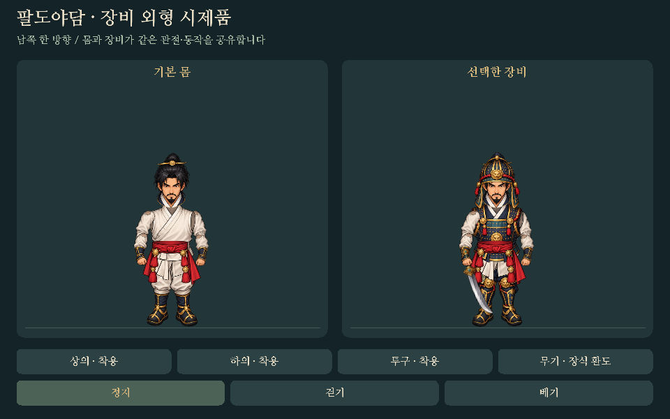

# 장비 외형 시제품 · 1차

2026-10-22. 기준 main `04cb6c5`, 브랜치
`graphics/equipment-appearance-prototype-20261021`.

Spine 구매 없이 기존 C11/SDL2에서 몸과 장비를 조합할 수 있는지 확인하는
**남쪽 한 방향의 독립 실행 시제품**이다. 본게임의 주인공이나 가방을 교체하지 않는다.
정지·걷기·베기의 같은 관절 경로에 상의·하의·투구·무기를 붙인다.
이 결과를 검토한 뒤 독립 방향 원화와 본게임 연결을 진행한다.



[실제 SDL 동작 GIF](equipment-motion-review.gif) ·
[24가지 조합](equipment-loadouts-review.png)

## 실행

SDL2가 있는 환경에서 저장소 루트 기준:

```sh
cmake -S . -B build-gear -DPALDO_BUILD_EQUIPMENT_PREVIEW=ON
cmake --build build-gear
ctest --test-dir build-gear --output-on-failure
./build-gear/paldo-equipment-preview --assets assets --parts art/hero/equipment/cutout-south-v1.png
```

Windows 실행 파일은 `.exe`이며 실행 파일 옆에 SDL2.dll이 필요하다.
Visual Studio의 다중 구성 빌드는 해당 구성 하위 폴더에서 실행 파일을 찾는다.
기본 CMake 옵션은 OFF라 일반 게임 빌드에는 시제품을 추가하지 않는다.
CI의 네이티브 검사만 ON으로 켠다. Android·웹 게임의 소스 목록과 배포 조건은 그대로다.

- 화면의 상의·하의·투구·무기 버튼: 개별 교체. 마우스 및 SDL 기본 터치→마우스 변환 사용.
- `1/2/3`: 상의·하의·투구 켜기/끄기. `4`: 검 없음→기본 환도→장식 환도.
- `I/W/A`: 정지/걷기/베기. `Space`: 움직임 일시정지. `Esc`: 종료.
- `--size 844x390`: 화면 크기. 최소 640×390.
- `--smoke frame.bmp --motion slash --phase 0.4 --loadout 23`: 고정 장면 출력.
  `--phase`는 0..1, 조합 번호는 0..23이다.
  조합 번호의 하위 3비트가 상의·하의·투구, 정수 나눗셈 `번호/8`이 무기 종류다.

## 그림과 표시 계약

- 내장 ImageGen 사용. `art/hero/directions/eight-direction-master.png`의 남쪽 주인공을
  얼굴·상투·수염·색감 기준으로 삼았다. 원래 완성형 스프라이트에서 옷을 자동 추출한 것이 아니다.
- `art/hero/equipment/cutout-south-master.png`: 새 4×4 분리 부품 원화.
  요청은 1536²였지만 실제 출력은 **1254² RGBA**다. 전체 프롬프트는 같은 폴더에 보존한다.
- 최초 투구의 검은 얼굴 내부가 인물을 가려, ImageGen으로 투명한 얼굴 구멍을 교정했다.
  `helmet-open-master.png`에서 **투구 한 부품만** 사용하고 나머지 부품은 첫 원본에서 가져온다.
  교정 이미지 전체를 기존 원본에 덮어쓰지 않는다.
- `scripts/prepare_equipment_assets.py`: 전체 원화의 연결된 알파 영역을 선택한다.
  검 손잡이 등이 명목 셀을 넘어가므로 단순 등분하지 않는다.
  알파 5 미만 잡점을 제거하고 비율을 유지해 알파 사전 곱 Lanczos로 축소한다.
  그림을 덧그리거나 색을 바꾸거나 좌우 반전하지 않는다. 붉은색으로 마스킹하지 않는다.
- 실행본 `cutout-south-v1.png`: **1024² RGBA**, 4×4/256px 셀,
  각 부품 최대 224px와 최소 16px 셀 여백. 완전 투명 픽셀 **72.49%**.
  셀 안의 실제 그림 영역은 생성된 `src/equipment_atlas_data.h`에 기록한다.
  원본·실행본 SHA-256과 선택 영역은 `preparation.json`에 기록한다.
- 128×192 기준 좌표계, 발 기준점 `(64,176)`. 머리·몸통·골반·양쪽 상완·양쪽 전완/손·
  양쪽 다리와 장비를 분리한다. 기준 몸은 흰 속옷과 고정 장화/손목 보호구이며 무기를 포함하지 않는다.
  **붉은 천 허리띠는 공통 몸 레이어**로 장비를 벗어도 유지한다. 피·혈흔·피 입자 없음.
- 상의는 민소매 갑옷 한 벌, 하의는 양쪽 갑옷 다리 한 벌, 투구 하나, 검 두 종류다.
  각 부품은 관절 끝이 겹치도록 배치한다. 회전·이동 중에도 비율과 발 기준점을 유지한다.
  검 손잡이는 **해부학적 오른손**에만 붙이고 손 부분을 검 위에 다시 그려 손잡이를 가린다.
- 다리/골반→왼팔→몸/상의→허리띠→머리/투구→오른팔→검→잡은 손 순서다.
  관절 경로는 장비와 독립되어 24가지 조합 모두 같은 몸/오른손 좌표를 사용한다.
  그림은 수평 반전하지 않는다.
- 정지는 고정 자세, 걷기는 거리 입력 없는 단순 다리/팔 회전과 몸 출렁임의 0.8초 순환이다.
  베기는 6개 관절 키를 보간한 0.64초 표시 시연이다. 실제 게임의 공격 키나
  타격 순간에 맞춘 완성 공격 원화가 아니며 피해·충돌·무공 판정은 없다.
- 전체 회전 사각형을 포함하는 표시 경계를 계산한다. 미리보기는 머리 위 검 궤적을 위한
  고정 여백을 두어 발이나 그림이 시간마다 자동 확대·축소되지 않는다.

## 검증과 한계

Windows / Clang 19.1.7 (Zig 0.14.1) / SDL 2.32.10 / CMake 4.4:
전체 CTest **11/11** 통과. 새 장비 검사는 **8,171,148개 조건**으로
24조합 고유 렌더링, 세 동작, 장비와 독립된 오른손 경로, 손/검 연결,
정지 복귀·걷기 순환, 1/2/3배에서 픽셀 경계와 잘림, 잘못된 크기·누락 PNG 처리를 검사했다.
새 도구의 실제 SDL 이벤트 처리기를 통한 버튼·키·자동 반복 차단·일시정지·종료,
640×390/844×390/1280×720 버튼 범위와 2배 화면 좌표 변환도 확인했다.

실제 시제품에서 정지 24조합 + 걷기 16장 + 베기 16장 + 화면 크기 3장,
**59장**을 렌더링해 위 PNG/GIF를 만들었다. 작은 화면과 머리 위 검/투구 얼굴 구멍,
허리띠·목·손·발 위치를 시각 검토했다. GIF의 색 수 축소는 리뷰 파일에만 적용한다.
본게임의 기존 `src/main.c`, `game.c/h`, `draw.c/h`, `assets/`는 수정하지 않았고,
기존 영웅/몬스터·입력/전투·모바일 크기 UI 회귀 검사도 통과했다.

남은 작업:

- **다른 7방향과 독립된 걷기/공격 원화, 네 무공, 본게임 가방/장착 연동은 미구현.**
- 이 걷기는 한 방향 관절 시연이며 기존 8방향 걷기 원화 품질이나 원근 회전을 대체하지 않는다.
  무릎을 굽히는 다리 분할·몸통 회전·옷자락 움직임·자세별 앞뒤 가림은 후속 작업이다.
- 상의 소매/어깨 보호구, 장화/장갑 슬롯, 다양한 체형·장비군, 얼굴/머리 가림 규칙 확대도 필요하다.
  현재 상의는 흰 소매를 남기는 민소매 갑옷이다.
- 실제 휴대폰 터치, 브라우저에서의 시제품 조작, Android APK, 성능과 메모리 측정,
  이번 Windows 빌드의 ASan/UBSan은 미검증이다.
- 제작/드롭/능력치/저장·맵/NPC/퀘스트 변경 없음. Spine 파일·런타임·유료 의존성 없음.
  `GAME_BIBLE.md`는 없고 세계관 변경도 없어 생성하지 않았다.
- 사용자 검토 전 main 병합/Pages 배포 없음. 다음 독립 단계는 이 원화·방식 검토 후 진행한다.
