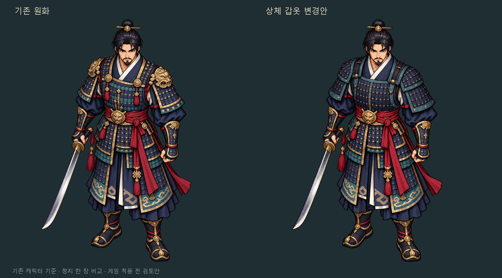

# 기존 원화 기준 장비 변경 비교 · 1차

2026-10-22, 기준 main `04cb6c5`.
브랜치 `art/hero-equipment-reference-edit-20261022`.

사용자가 기존 캐릭터의 성인 체형과 그림체를 유지한 수정을 요청했다.
앞선 PR #38의 새 부품 조립 캐릭터/관절 회전 공격은 불채택되어 초안·보류 상태다.
그 후보의 그림·코드를 가져오지 않고 최신 main에서 원화 한 장 비교만 진행했다.

## 이번 시도

- 편집 대상은 기존 `art/hero/warrior-clarity-master.png` 자체다.
  이를 단순 분위기 참고로 새 캐릭터를 만드는 대신, 기존 완성형 인물의 상체 갑옷을 편집하도록 요청했다.
- 내장 ImageGen 사용. 상체의 금 사자 어깨 장식과 가슴 장식을 덜어내고,
  남색 철판/청록 테두리/작은 금속 고정구를 사용하는 같은 크기의 갑옷으로 바꾼 비교안이다.
  새 아이템 이름/수치/드롭/세계관 설정을 확정한 것이 아니다.
- 얼굴·상투·머리 크기·목·어깨 폭·몸통·팔다리·서 있는 자세·손·오른손 환도·붉은 천 허리띠·
  하체와 장화는 기존 그림을 유지하도록 요청했다. SD 체형이나 단순 부품 회전 모션을 사용하지 않았다.
- `art/hero/equipment-reference-edit/upper-armor-candidate-v1.png`는 생성 출력의 바이트 그대로다.
  기존 원본을 덮어쓰지 않았으며, `upper-armor-prompt.txt`에 실제 전체 프롬프트를 보존했다.
- `docs/equipment-reference-comparison.png`는 두 1254² 전체 캔버스를 같은 배율·같은 여백으로 나란히 놓은
  리뷰 이미지다. 한쪽만 몸/얼굴을 늘리거나 실루엣에 맞춰 크기를 조정하지 않았다.

## 확인한 사실과 제한

- 원본/편집안 모두 **1254×1254 RGBA**다. 편집안의 완전 투명 픽셀 비율은 **69.96%**다.
- 알파 32 초과의 전체 인물 경계:
  원본 `(195,3)-(965,1246)`, 편집안 `(194,2)-(966,1247)`.
  실루엣 교집합/합집합은 98.88%로, 전체 배치·크기 비교용 수치이며 미술 품질 점수가 아니다.
  머리/몸 비율·어깨/팔/다리·검 각도와 장화 위치는 나란히 시각 검토했다.
- 생성 편집 때문에 **상체 갑옷 밖의 얼굴 선·명암·하체 장식 등에도 미세한 재묘사 차이가 있다.**
  갑옷 영역만 픽셀 단위로 교체하거나 나머지를 완전히 동일하게 보존했다고 주장하지 않는다.
- 이것은 한 장의 완성형 그림을 바꾼 **미술 검토안**이다.
  몸·상의·무기 등을 실제 분리한 레이어, 정지 방향 아틀라스, 걷기/공격 프레임은 아직 아니다.
  원본과 다른 갑옷을 같은 캐릭터로 읽을 수 있는지부터 사용자 검토가 필요하다.
- 원본·생성본·비교 이미지의 SHA-256, 크기·알파·경계는 `review.json`에 기록했다.
  원본은 Git의 기준 파일과 바이트 일치함을 확인했고, 코드·기존 assets의 변경도 없다.
- 피/혈흔/피 입자 추가 없음. 환도는 기존 해부학적 오른손, 붉은 허리띠는 유지한다.

## 검증 범위와 다음 단계

이번 변경은 새 `art/` 후보·리뷰 PNG·프롬프트·기록 문서에 한정한다.
`src/`, `assets/`, CMake, 워크플로를 수정하지 않았고 게임에서 후보를 불러오지도 않는다.
따라서 CMake/CTest·게임 실행 회귀·브라우저/모바일 실행 검사는 새로 수행하지 않았다.
원본 보존·PNG/알파/전체 크기·배치·실제 변경 범위·문서 참조를 검사했다.

이번 결과가 검토되기 전에는 다른 장비/방향/공격 프레임을 대량 제작하거나 본게임에 적용하지 않는다.
후속 작업에서도 기존 전신 프레임의 몸통 회전·하체 지지·무게중심·옷자락을 기준으로 한다.
PR #38은 불채택 기록으로 남긴다. main 병합·Pages 배포·버전 변경 없음.
