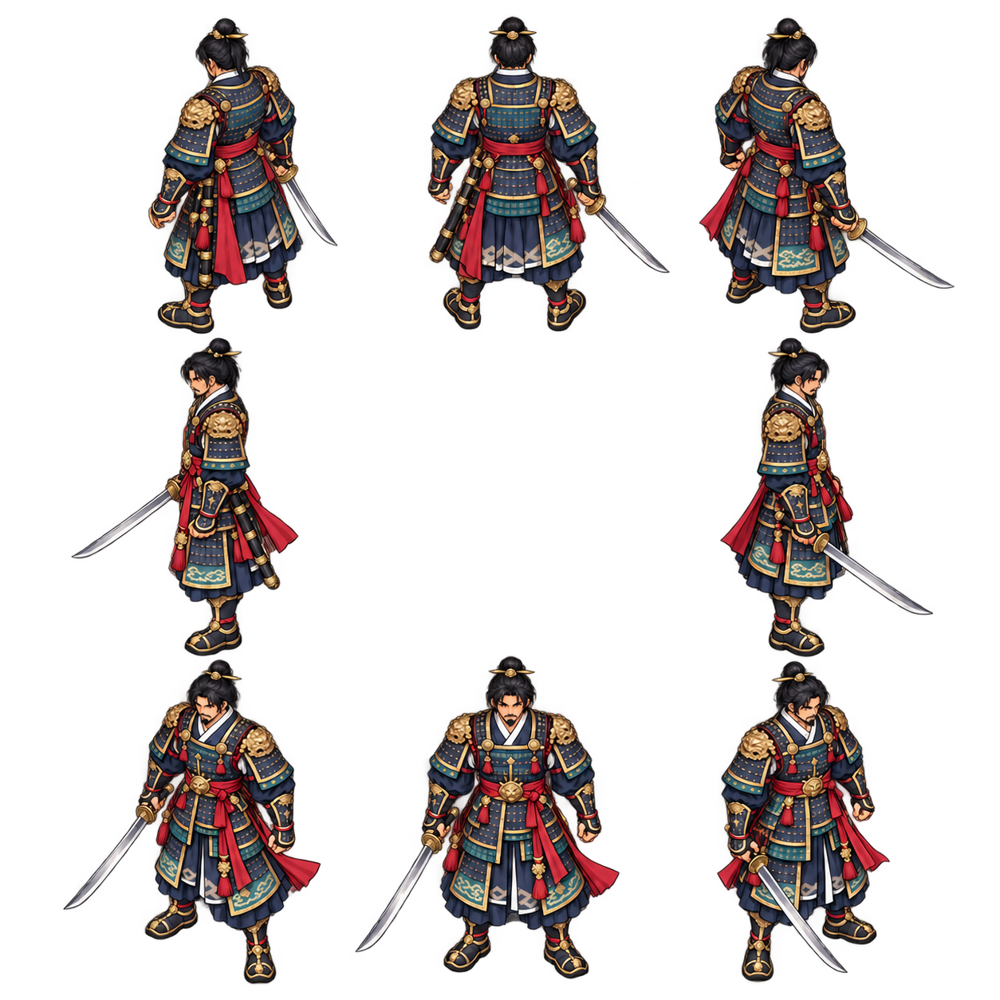

# 주인공 8방향·오른손 정지·걷기

사용자가 기준 원화와 정지·걷기 구현을 승인했다. PR #15 후보는 실행용 정지 8포즈와 방향별 8프레임 걷기를 연결한다. 공격 8방향은 다음 독립 단계다. 현재 공개 main에는 이 후보를 병합·배포하지 않았다.

## 현재 코드에서 확인한 것

- 기준 main: `07f39936cddc56c5091fa0b6a973b5e765789b5a` (기술 전용 원화 PR #14 병합·배포 이후).
- `Hero.dir`는 이미 2차원 벡터다. `game_tick`은 입력 길이를 정규화하고 이동/지형 충돌 결과로 발걸음 주기를 진행한다. 대각선 이동 속도를 새로 바꾸거나 맵/충돌을 재구성할 필요가 없다.
- 기존 `Hero.face/attack_face`는 좌우 두 값이며 수평 반전하면 무기 손까지 바뀐다. 후보는 정지·걷기를 `Hero.dir`의 8구간으로 선택하고 반전을 사용하지 않는다. 공격의 `attack_face`는 그대로다.
- 공격은 시작 시 정한 `attack_angle`/`skill_angle`과 `attack_face`를 별도로 보관한다. 이동 방향과 공격 방향을 같은 순간값으로 덮어쓰면 기존 고정 공격 방향과 충돌할 수 있으므로 분리해서 연결해야 한다.

## 원하는 표현

고정된 현재 카메라에서 인물 전체가 8방향으로 돌아가는 2D 원화를 사용한다. 정지·걷기·평타·4무공 모두 같은 해부학적 오른손에 칼을 들어야 한다. 왼손은 비우고 칼집은 왼쪽 허리에 둔다. 반대 방향 그림을 단순 반전해 만들지 않는다.

정면에서는 오른손이 화면 왼쪽에, 뒷모습에서는 화면 오른쪽에 나타난다. 옆모습에서 오른팔이 몸 뒤에 있는 방향은 자연스럽게 가려져야 하며, 잘 보이게 하려고 왼손으로 칼을 옮기지 않는다. 뒷모습은 얼굴만 뒤로 돌리지 않고 등 갑옷·어깨 뒤·뒤통수·발 방향을 모두 맞춘다.

원화 시트는 중앙을 비운 나침반 배치로 검토한다. 현재 결과는 참고 일러스트 시트이므로 균일한 셀 분할이나 공통 발 기준점이 맞춰진 실행용 아틀라스로 취급하지 않는다.

| 왼쪽 열 | 중앙 열 | 오른쪽 열 |
| --- | --- | --- |
| 북서 NW: 왼쪽 뒤 대각선 | 북 N: 뒷모습 | 북동 NE: 오른쪽 뒤 대각선 |
| 서 W: 왼쪽 옆모습 | 비움 | 동 E: 오른쪽 옆모습 |
| 남서 SW: 왼쪽 앞 대각선 | 남 S: 정면 | 남동 SE: 오른쪽 앞 대각선 |

그림 기준은 기존 승인 주인공이다. 상투·수염·남색/청록 갑옷·금 장식·흰 깃·붉은 천 허리띠·장화·은색 환도를 유지한다. 혈흔·피 입자를 추가하지 않는다. 등 갑옷은 사용자가 승인한 기준 원화의 묘사를 따른다.

실제 생성 master는 1254×1254 RGBA다. 초기 프롬프트와 북서 포즈 교정 프롬프트를 같은 폴더에 보존했다. 시각 검토 후 오른손·빈 왼손·칼집 관계를 교정하고 사용자 승인을 받은 결과다.

## 정지·걷기 표시 계약

- `assets/warrior-idle-8dir-v1.png`: 정지 8포즈, 4×2, N/NE/E/SE/S/SW/W/NW 순서. 정지 시 마지막 `Hero.dir`를 유지한다. 초기 동쪽 방향도 기존 초기 벡터 그대로다.
- `assets/warrior-walk-{n,ne,e,se,s,sw,w,nw}-v1.png`: 방향별 8프레임 걷기 8장, 각 4×2 순서. 이동 거리 112당 한 주기라는 기존 규칙을 유지한다. 느린 입력은 느린 발걸음, 벽에 막히면 정지다. 표시 방향은 충돌 후 이동 벡터 대신 기존 마지막 입력 방향을 따른다.
- 모든 실행 PNG는 768×384 RGBA/192px 정사각 셀이다. 발 기준점 `(96,176)`, 그림 상자 56×56, 몸 높이 약 43 논리 픽셀로 기존 인물 크기를 맞춘다. 최근접 샘플링과 WORLD_ZOOM 1.20 유지. 별도 원화를 선택하며 좌우 반전·몸통 회전 없음. 정지·걷기 가림 폭도 56으로 맞춰 북동쪽 검 끝을 포함한다. 기존 지붕/나무 폴리곤과 가림 방식은 그대로다.
- 방향은 북쪽부터 시계방향 45도 구간, 중심에서 ±22.5도다. 입력이 없을 때 `Hero.dir`가 유지되므로 정지/메뉴에서도 같은 방향을 표시한다. 별도 이동 상태나 저장 구조를 추가하지 않았다.
- `art/hero/directions/walk/*-master.png`는 내장 ImageGen의 실제 결과다. N/E/S/SW/NW 1536×1024, NE/SE/W 1774×887. 방향별 서 있는 참조를 사용했으며 북쪽 검 끝 여백 교정 프롬프트도 보존한다.
- `python scripts/prepare_direction_assets.py` (Pillow)로 실행 PNG 재현. 연결 알파 실루엣을 명목 셀 밖까지 분리하고, 알파 1..4 잡점만 제거한 뒤 비율 유지/프리멀티플라이드 알파 축소/몸통 축과 장화 바닥 정렬. 머리·검·허리띠 잘림과 셀 가장자리 4px 이상 검사. 원본은 보존하며 빨간색을 지우거나 프레임을 복제/보간하지 않는다. SHA-256·원본 크기/알파·프레임 선택/기준점은 `preparation.json`에 기록한다.

실제 SDL 표시: [정지 8방향](hero-eight-direction-idle.png), [걷기 8방향](hero-eight-direction-walk.gif), [게임 전후](hero-eight-direction-gameplay.png). [검증 기록](VALIDATION.md)의 이번 단계 결과와 한계를 함께 확인한다. 발 기준점 정렬은 3D 리깅이나 완전한 발 미끄러짐 제거를 뜻하지 않는다.

## 적용 작업을 나누는 기준

1. 완료/사용자 승인: 8방향 정지 기준 원화의 오른손과 앞/뒤/옆/대각선 검토.
2. 이번 후보: 정지·걷기 시트, 마지막 정지 방향, 대각선 시점, 공통 발 기준점 연결 및 이동/입력/가림 회귀. 사용자 결과 검토 대기.
3. 이동 단계 검토 후: 평타·4무공을 같은 방향/오른손 기준으로 확장. 공격 방향 고정·0.64초 기술/0.24초 타격·버퍼/콤보·전진/후퇴·히트스톱을 보존하고 공격/렌더링 회귀 검사.

현재 **평타·4무공은 기존 좌우 반전**이므로 공격 중 시점과 무기 손이 달라질 수 있다. 정지·걷기만으로 전체 동작의 오른손 고정이 완성됐다고 주장하지 않는다. 실제 3D 모델링/카메라/맵 투영을 추가하지 않았으며 방향별 2D 원화로 입체적인 이동 시점을 표현한다.

전투/입력/맵 로직·기존 공격/기술 PNG·NPC/퀘스트·배포 설정은 변경하지 않았다. 실제 iPhone/Android/APK 표시·성능과 이번 변경의 브라우저 실행은 미검증이다. 다음 독립 단계와 병합·배포는 저장소 `AGENTS.md`의 승인 규칙에 따른다.
