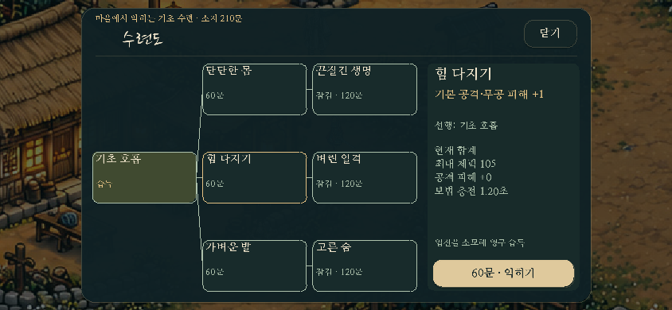
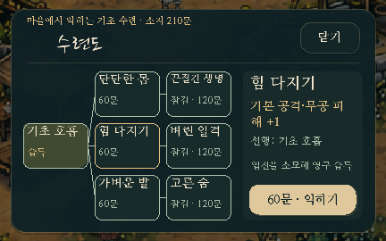

# 패시브 수련도 1차

최초 기준 main `68f648f`, 병합 전 통합 기준 main `bb9eadf`(#69 정혼주·#70 토벌 포함), 작업 브랜치 `feat/passive-cultivation-tree-20261118`.
사용자 요청: 패시브 수련 트리 구현. 희귀 성장 재화는 Claude가 별도 작업 중이다.

## 플레이

가방 상단 또는 일시정지 화면의 **수련도**를 누른다. 노드를 선택하면 효과·선행 조건·비용을 볼 수 있고, 마을에서 엽전을 지불해 한 번씩 익힌다. 다른 지역에서는 조회만 가능하다. 메뉴를 열면 기존 패널처럼 전투·이동·재등장 시계가 멈춘다. 닫기/Esc로 플레이에 복귀한다. 별도 단축키를 추가하거나 기존 키 설정을 변경하지 않았다.

| ID | 수련 | 선행 | 비용 | 효과 |
| --- | --- | --- | ---: | --- |
| 0 | 기초 호흡 | 없음 | 30문 | 최대 체력 +5 |
| 1 | 단단한 몸 | 기초 호흡 | 60문 | 최대 체력 +5 |
| 2 | 끈질긴 생명 | 단단한 몸 | 120문 | 최대 체력 +10 |
| 3 | 힘 다지기 | 기초 호흡 | 60문 | 기본 공격·무공 피해 +1 |
| 4 | 벼린 일격 | 힘 다지기 | 120문 | 기본 공격·무공 피해 +1 |
| 5 | 가벼운 발 | 기초 호흡 | 60문 | 보법 충전 시간 -0.05초 |
| 6 | 고른 숨 | 가벼운 발 | 120문 | 보법 충전 시간 -0.05초 |

비용·명칭·효과는 이번 플레이 검토를 위한 1차 값이다. 총 570문이며 전체 습득 시 체력 120, 기본 공격·무공 피해 +2, 보법 충전 1.10초다. 각 노드는 1단계이고 세 갈래를 모두 배울 수 있다. 직업·배타 선택·무한 반복 투자·초기화 기능은 없다.

- 최대 체력 증가는 현재 체력을 회복하지 않는다. 이후 탕약·식사·사망 회복은 증가한 상한을 사용한다.
- 공격 피해는 기존 장비 보너스에 더한 다음 기존 연계·간파 배율을 적용한다. 바람 증강의 별도 6피해에는 추가하지 않는다. 범위·속도·공격 입력·피격 규칙은 그대로다.
- 보법의 새 충전 주기에만 단축을 적용한다. 이미 진행 중인 충전 잔여는 유지하고 HUD의 진행률은 새 기본 시간을 사용한다. 충전 수·무적 시간·이동 거리는 그대로다.
- 선행 미습득·중복·잘못된 ID·잔액 부족·비정상 상태·마을 밖·허수아비 수련 중 구매를 거부한다. 실패 시 재화와 성장 상태가 함께 유지된다.
- 새 여정에서는 노드가 초기화된다. 왕복·사망·재도전·이어하기는 습득을 유지한다. 허수아비 수련장은 본편의 노드 효과를 복사하고, 종료 시 원래 상태를 복원한다.

## 실제 SDL 출력

## 저장과 Claude 작업 연결

`src/cultivation.c/h`가 노드 표·효과 합산·구매 트랜잭션을 맡는다. `Game.cultivation_nodes`는 고정 ID의 7비트이며 새 노드는 뒤에 추가한다. 저장에는 비트만 추가하고 효과를 따로 누적하지 않아 불러올 때 이중 적용하지 않는다. 알 수 없는 비트·선행 누락·노드와 최대 체력의 불일치를 거부한다.

통합 저장은 **v6, 940바이트**다. 배포된 v5(936바이트)의 정혼주 파편·정혼주 필드를 그대로 두고, 기존 체크섬 앞에 습득 노드 uint32를 추가했다. v1~v5는 노드 0으로 읽고, v5의 재화 수량은 유지한다. 최초 로컬 후보의 932바이트 v5는 업로드·배포되지 않았으므로 공개 형식으로 취급하지 않는다. 게임 출시 버전은 0.8.0이다.

기초 수련은 승인된 1차 안대로 기존 엽전을 사용한다. 정혼주 수량·드롭·정제는 #69의 구현을 보존했다. 정혼주를 소비하는 상위 노드는 후속 범위다.

#70의 `src/raid.c/h`는 수정하지 않았다. 토벌 입장 시 영구 노드와 체력 상한을 유지하며, 토벌 중 수련도 진입·구매를 거부한다. 기본 공격·무공의 영구 피해는 기존 임시 보너스와 합산한다. 보법은 영구 단축을 먼저 적용하고 `raid_dodge_recharge`의 임시 단축과 기존 최소값 0.4초를 적용한다. 토벌 종료 시 원래 체력·노드·정혼주를 복원한 뒤 기존 토벌 보상만 받는다. 토벌 임시 상태는 저장하지 않는 기존 규칙을 유지한다.

## 검증 범위

`tests/test_cultivation.c`: 128개 노드 조합의 유효성·저장 왕복, 선행·중복·잔액·상태 검사, v1~v5 이전 기록, 손상된 비트/체력 상한, 정혼주와 노드의 동시 보존·토벌 효과 중첩과 복원, 실제 기본 공격·무공 피해, 보법 충전, 수련 복원·사망·새 여정.

`tests/test_cultivation_ui.c`: 실제 포인터 입력으로 가방 → 수련도 → 노드 선택 → 구매/잠금/중복 차단 → 닫기, 마을 밖 조회. 432×270부터 1920×1080까지 7개 화면에서 버튼 경계·겹침·44px 이상 높이 확인.

전체 검증 결과는 CURRENT_STATE.md와 VALIDATION.md에 기록한다. 실기기 Android/iPhone, Windows, 브라우저 수동 플레이와 장기 밸런스는 미검증이다. Emscripten 빌드는 PR CI에서 확인한다.
