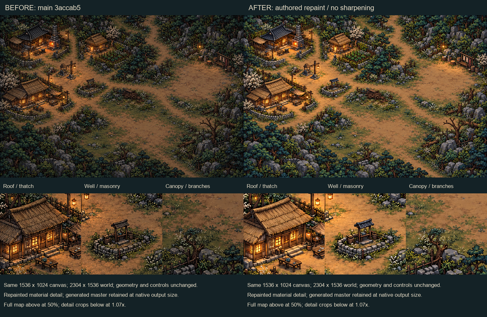
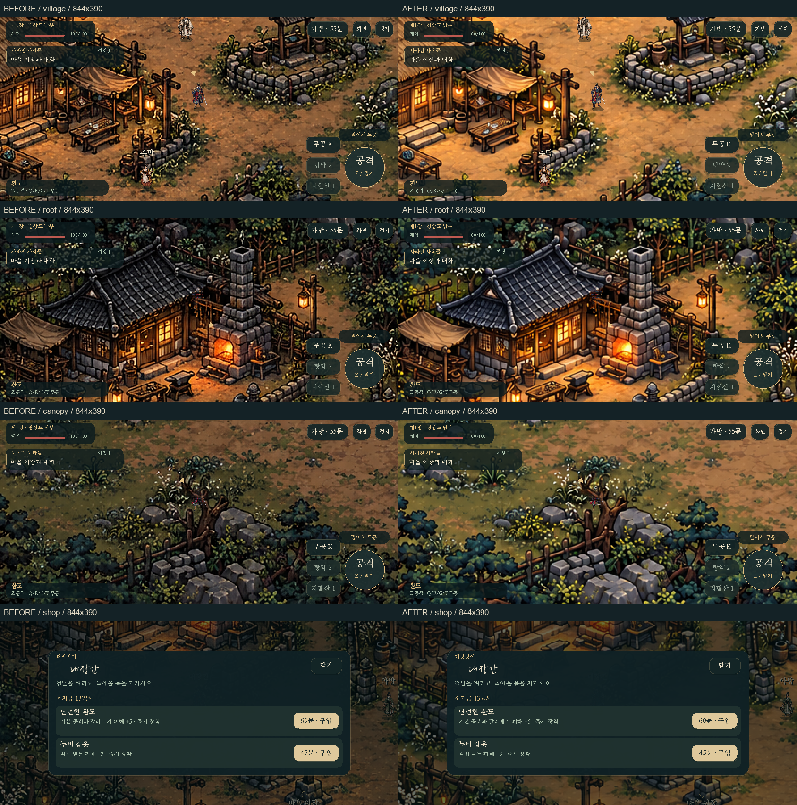
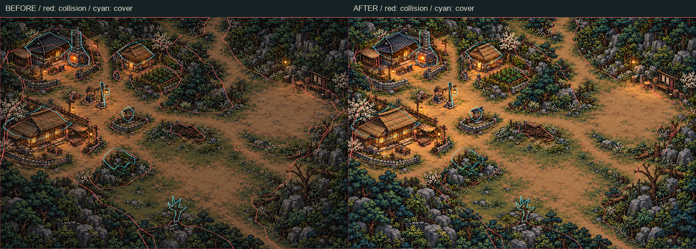

# 마을 배경 원화 리메이크 1차 · 사용자 리뷰 후보

작업일: 2026-10-19. 기준: 원격 `main`의 `3accab5b8a4024421a01082ef31cd2f558d55a38`.
브랜치: `graphics/village-hires-remake-pass1-20261019-review`.
리뷰: [PR #10](https://github.com/yousay0526-sudo/Paldoyadam/pull/10).

## 변경과 원본

기존 마을을 내장 ImageGen 편집으로 다시 그려 기와·초가·목재·석축·수목의 재질과 선을 정리했다. 기존 배경을 편집 대상으로, 승인된 주인공 원화를 스타일 참고로 사용했다. 집·우물·길·수레·수목·울타리의 배치를 유지하고 새 건물·캐릭터·장애물을 추가하지 않았다. 조선풍과 따뜻한 등불을 유지하면서 원본보다 밝은 재질과 명암으로 주인공의 정돈된 그림과 조화를 맞춘 후보다.

| 파일 | 용도 |
| --- | --- |
| `assets/village.png` | 실행 배경, 생성 master와 바이트 단위 동일 |
| `art/village/village-remake-pass1-master.png` | 수정하지 않은 ImageGen 결과 |
| `art/village/village-remake-pass1-prompt.txt` | 참조 역할·고정 배치·금지 항목을 포함한 전체 프롬프트 |
| `scripts/review_village_asset.py` | master 동일성·불투명 캔버스·보호 파일·배치 보조 검사 |
| `docs/village-remake-pass1-layout.json` | 기준 커밋, 이미지/보호 파일 SHA-256과 16지점 측정 |

실제 생성 결과는 **1536×1024 RGB**다. 프롬프트에는 3072×2048을 요청했지만 결과가 그 크기가 아니므로 업스케일로 대체하지 않았다. 이 1차는 원화 묘사를 개선한 후보이며, 2배 해상도 배경을 완성했다는 의미는 아니다. 원본 이미지는 기준 커밋의 `assets/village.png`로 재확인할 수 있다.

`src/draw.c`의 이전 명도 언샵 처리와 임시 복사 버퍼를 제거했다. 배경의 최근접 샘플링은 유지한다. 신규 PNG에 로딩 필터·샤픈·후처리는 적용하지 않는다. 월드 2304×1536, 줌 1.20, 발 기준점, 가림의 지도 재표시 방식, 충돌과 경로·퀘스트·전투·조작은 변경하지 않았다. 버전은 0.8.0을 유지한다.

## 전후 비교

왼쪽은 기존, 오른쪽은 후보다. 첫 보드는 PNG 원화 자체 비교이며 전체 지도는 50%, 세부 발췌는 약 1.07배다. 게임 비교는 기존 코드의 샤픈을 포함한 기준판과, 새 원화 및 필터 제거가 적용된 수정판을 각각 직접 실행한 화면이다.







지도와 실제 게임에서 주요 구조물, 열린 문·골목, 우물, 주인공과 NPC, 지붕·나뭇가지 가림, 상점 UI를 시각 검토했다. 기존 지붕의 일부는 원래부터 다각형 경계 바깥으로 나온다. 이번 원화에 맞춰 충돌·가림 폴리곤을 임의로 넓히지 않았다.

## 실행한 검증

Windows x86-64, Zig 0.14.1의 Clang 19.1.7, C11, 공식 SDL 2.32.10 배포본. CMake가 없는 환경이어서 CMake 대상과 같은 소스 조합을 직접 빌드해 실행했다. `-Wall -Wextra -Wpedantic -O2`, SDL dummy/소프트웨어 렌더러를 사용했다. CTest 실행을 주장하지 않는다.

| 그룹 | 결과 |
| --- | --- |
| `tests/test_game.c` | 528개 통과: 퀘스트·거래·소모품·복구·정지·기술·콤보 |
| `tests/test_world.c` | 142개 통과: 문·왕복 경로·돌진·벽 너머 공격 |
| `tests/test_controls.c` | 317개 통과: 실제 SDL 입력, 스와이프·다중 터치·취소·가방 |
| `tests/test_ui.c` | 1,518개 통과: 작은 가로 화면, 대사, 1/1.25/2배 클리핑 |
| `tests/test_hero_render.c` | 109,272개 통과: 정지·이동·공격·기술 1/2/3배 및 배경 원본 픽셀 |
| 네이티브 장면 스모크 | 전후 각각 8장, 총 16장 모두 정상 종료 |
| 원화/배치 QA | 불투명 1536×1024, master 일치, 보호 파일 10개, 주요 지점 16개 통과 |

추가 원격 검증: 코드 커밋 `f3b37b6`의 [GitHub Actions 39244411655](https://github.com/yousay0526-sudo/Paldoyadam/actions/runs/39244411655)가 성공했다. Linux에서 CMake 전체 빌드·CTest를 통과했고 Emscripten 3.1.74의 웹 파일과 단일 HTML 빌드를 완료했다. 배포 작업은 PR 조건에 의해 skipped였다. 이는 브라우저 상호작용이나 실제 휴대폰 실행 검증을 의미하지 않는다.

스모크 장면: `village` 432×270 / 844×390 / 1100×650, `roof`·`canopy`·`shop`·`npc`·`skill2` 844×390. 게임 화면 보드에는 마을·지붕·나뭇가지·상점 네 장면을 보존했다.

추가 렌더링 회귀 검사는 지도 3곳(대장간, 우물, 남쪽 나무)의 각 288×288 영역을 실제 SDL 텍스처에서 읽어 PNG 디코딩 픽셀과 정확히 비교한다. 기존 지도 크기와 최근접 샘플링 검사도 유지했다. 원본 데이터와 달라지는 필터가 다시 들어오면 실패한다.

새 렌더링 테스트를 기준판 `src/draw.c`와 연결한 대조 실행은 픽셀 비교에서 **예상대로 실패**했다. 이후 수정판의 같은 테스트는 통과했으므로 이전 샤픈 재도입을 탐지함을 확인했다. `git diff --check`도 통과했다.

배치 검사는 56×56 패치의 가우시안 sigma 1 / 밝기 기울기 NCC를 ±10px 범위에서 비교한다. 15곳 최적 이동량 (0,0), 대장간 지붕 (0,-1), NCC 0.6553~0.8710. 허용 기준은 축별 2px 이하와 NCC 0.55 이상이다. **국소 질감 정합성만 검사하므로 전체 실루엣 동일성이나 모든 통로를 증명하지 않는다.** 원화 전후 오버레이·실제 가림 화면 및 변경 없는 지형 테스트를 함께 검토한다.

초기 환경 문제: Git/PowerShell의 Windows TLS 인증이 실패해 Git의 OpenSSL 백엔드와 Python 다운로드를 사용했다. 최초 SDL 정적 링크가 시스템 라이브러리 미해결로 실패해 공식 DLL import library를 명시한 GNU 대상 링크로 수정하고 위 빌드·검사를 완료했다. 제품 빌드 설정은 변경하지 않았다. 기존 stb 미사용 함수 경고, 입력 테스트의 signed 비교 경고, 로컬 명령의 `SDL_MAIN_HANDLED` 중복 정의 경고가 있었으며 빌드 오류는 없다.

## 다시 확인하기

이번 Windows 직접 빌드에서 사용한 명령 구조는 아래와 같다. 공식 도구 압축 파일을 저장소 바깥 `../tooling`에 풀었으며 캐시와 실행 결과도 작업 폴더 안에 한정했다. 게임은 `src/main.c src/draw.c src/game.c src/world.c`, 입력·UI·렌더링 검사는 해당 `tests/test_*.c src/draw.c src/game.c src/world.c`, 게임·지형 검사는 해당 `tests/test_*.c src/game.c src/world.c`를 컴파일했다.

```powershell
$zig = '../tooling/zig-x86_64-windows-0.14.1/zig.exe'
$sdl = '../tooling/SDL2-2.32.10/x86_64-w64-mingw32'
$env:ZIG_GLOBAL_CACHE_DIR = "$PWD/../tooling/zig-cache-gnu"
$env:ZIG_LOCAL_CACHE_DIR = "$PWD/../tooling/zig-local-gnu"
& $zig cc -target x86_64-windows-gnu -std=c11 -Wall -Wextra -Wpedantic -O2 `
  -DSDL_MAIN_HANDLED -Isrc -Ithird_party/stb "-I$sdl/include/SDL2" `
  src/main.c src/draw.c src/game.c src/world.c "$sdl/lib/libSDL2.dll.a" `
  -lm -o build-review/paldo-after.exe
Copy-Item "$sdl/bin/SDL2.dll" build-review/
$env:SDL_VIDEODRIVER = 'dummy'
./build-review/game.exe
./build-review/world.exe
./build-review/controls.exe
./build-review/ui.exe assets
./build-review/hero.exe assets
./build-review/paldo-after.exe --assets assets --smoke roof.bmp --scene roof --size 844x390
```

표준 SDL2/CMake 환경:

```sh
cmake -S . -B build-native -DCMAKE_BUILD_TYPE=Release
cmake --build build-native --parallel 2
ctest --test-dir build-native --output-on-failure
python scripts/review_village_asset.py
./build-native/paldo-yadam --assets assets --smoke roof.bmp --scene roof --size 844x390
./build-native/paldo-yadam --assets assets --smoke canopy.bmp --scene canopy --size 844x390
```

Python 검사는 제작 검토용 Pillow와 NumPy가 필요하다. 게임 런타임에는 Python이 필요하지 않다. 원화 재적용은 master를 `assets/village.png`에 그대로 복사하면 된다. 원본은 기준 커밋에서 추출하고 그 커밋의 실행 파일과 비교해야 기존 샤픈 포함 화면을 재현할 수 있다.

## 남은 확인과 승인

실제 iPhone Safari/Android의 화면 품질·밝기·프레임 속도·GPU 메모리는 미검증이다. 같은 이미지 치수와 PNG 증가량 약 51KB를 유지하지만 실기기 성능을 보장하지 않는다. 브라우저/WebAssembly 실행 및 Android APK 실행은 로컬에서 수행하지 않았다. PR의 CI 결과는 로컬 테스트와 구분해 기록한다.

사용자는 더 밝아진 배경, 주인공과의 그림 조화, 작은 화면 질감 및 기존 배치/가림 경계를 검토한다. 생성 리메이크이므로 개별 획과 잎·기와 묘사는 원본 픽셀과 다르다. 수정이 필요하면 이 후보와 기준 원본을 함께 사용해 후속 조정한다.

**PR은 사용자 승인 전 병합·자동 병합 예약·배포하지 않는다.** 현재 `main` 병합은 Pages 배포로 이어지므로 병합과 배포 각각의 명시적 승인이 필요하다. 정식 버전 변경 및 다음 독립 그래픽 작업도 수행하지 않는다. `GAME_BIBLE.md`는 없어 새로 작성하지 않았다.
