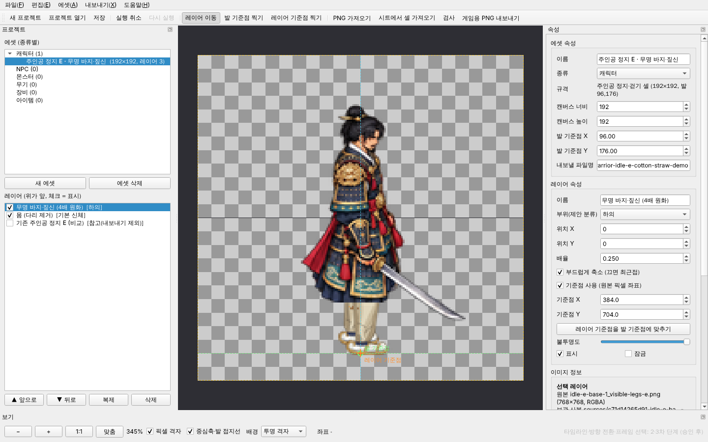
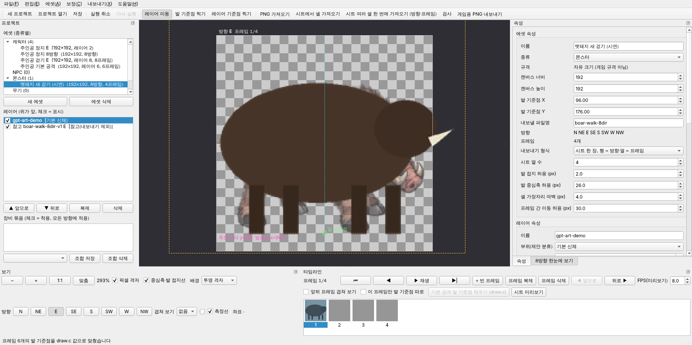
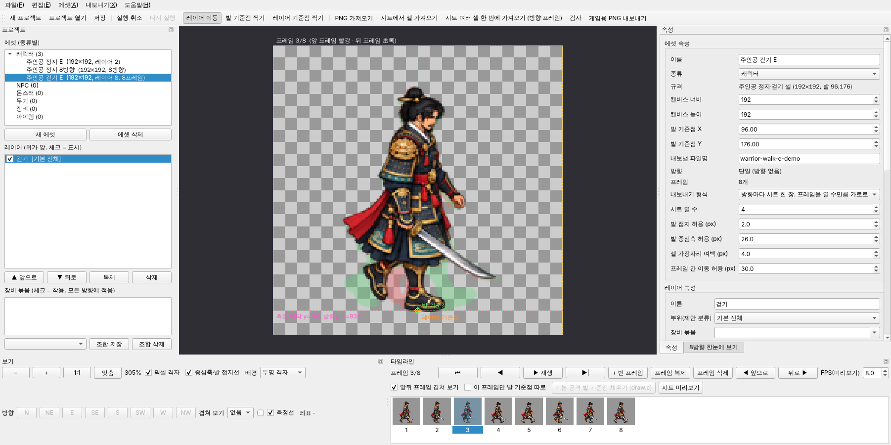
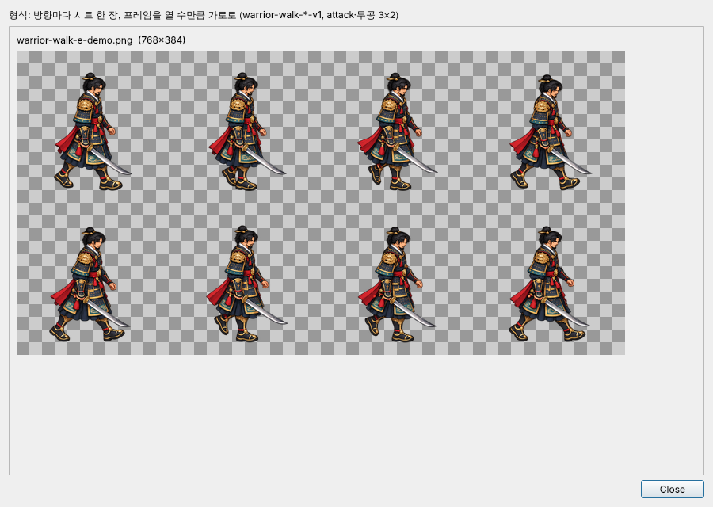
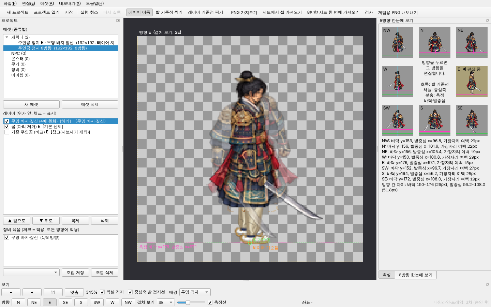

# 팔도 에셋 스튜디오 (Paldo Asset Studio) · 4차

팔도야담 캐릭터·장비·아이템 그림을 레이어로 겹쳐 보고, 발 기준점에 맞춰 배치한 뒤 게임용 투명 PNG로 내보내는 독립 GUI 프로그램이다. 게임 실행 코드(`src/`)·빌드(CMake)·실행 에셋(`assets/`)과 분리되어 있으며, 게임을 빌드하거나 실행하는 데 필요하지 않다.

설계·조사 근거·라이선스 검토·이후 단계는 [docs/DESIGN.md](docs/DESIGN.md)에 있다.



위 화면은 기존 주인공 정지 E 셀(다리 제거본)과 미병합 다리 연구 후보(PR #43, 미승인 E 한 포즈)의 무명 바지·짚신 4배 원화를 0.25배로 겹친 예시다. 저장소 main의 이미지만 쓴 화면은 [studio-main-repo-only.png](docs/screenshots/studio-main-repo-only.png).

## 설치

Python 3.10 이상 (확인: 3.13). 저장소 루트에서:

```sh
python -m pip install -r tools/asset_studio/requirements.txt
```

가상환경 사용을 권장한다(`python -m venv .venv-studio` 후 활성화). 게임 빌드에는 영향이 없다.

## 실행

```sh
python tools/asset_studio/run_studio.py                    # 빈 화면에서 시작
python tools/asset_studio/run_studio.py <프로젝트 폴더>      # 저장된 프로젝트 열기
```

시작할 때 상위 폴더에서 게임 저장소를 찾아(`src/draw.c`와 `assets/`가 있는 곳) 규격 프리셋을 읽는다. 저장소 밖으로 복사해 실행하면 "자유 크기" 프리셋만 쓸 수 있다.

## 4차: NPC·몬스터 제작 지원·템플릿·자동 보정



- **템플릿에서 새 에셋**(Ctrl+T): 캔버스·발 기준점·방향·프레임·프레임별 기준점·내보내기 형식·허용값을 한 번에 정한다. 기본 템플릿은 저장소에서 읽는다(값을 새로 정하지 않음): 주인공 정지 8방향·걷기 8방향×8프레임·기본 공격 6프레임(draw.c 기준점)·무공 6프레임, 몬스터는 `art/monsters/runtime.json`에 설치된 시트마다(멧돼지 정지·걷기·공격, 도축자 정지·걷기·기술; 192 셀·발 96,176, 정지 4×2, 동작은 행 = 방향 4프레임). "기존 실행 그림을 참고 레이어로 넣기"를 켜면 해당 실행 셀이 칸마다 참고 레이어(내보내기 제외)로 들어가 대고 그리거나 비교할 수 있다.
- **NPC**: 기본 템플릿이 없다. `assets/npcs.png`는 셀 폭이 서로 다른 띠 한 장(`src/draw.c`)이라 고정 셀 규격이 아직 없기 때문이다. 종류를 NPC로 두고 직접 만든 에셋을 **내 템플릿**으로 저장해 반복 사용한다.
- **내 템플릿**: "현재 에셋을 템플릿으로 저장"(Ctrl+Shift+T)은 그림 없이 구조만 `<프로젝트>/templates/*.paldo-template.json`에 저장한다. "템플릿 파일 가져오기"로 다른 프로젝트의 템플릿 파일을 들여온다.
- **보정 메뉴**
  - GPT 원화 가져오기(Ctrl+G): 원화 한 장을 현재 칸에 넣으며 배경 제거 → 잡점 제거 → 키 맞추기(같은 칸 참고 레이어 키 또는 숫자) → 발 맞추기를 한 번에 한다(실행 취소 한 번). 미리보기로 전후를 본다.
  - 선택 레이어 배경 제거·잡점 제거: 원본과 기존 사본은 그대로 두고 **보정본을 `sources/`에 새 사본**으로 만든다. 사본에는 무엇에서 어떤 설정으로 만들었는지(`derived`)가 기록된다.
  - 발 맞추기(현재 칸 / 모든 방향·프레임), 키 맞추기(참고 레이어 키로): 레이어 위치·배율만 바꾼다.
- 네트워크를 쓰는 AI 기능은 넣지 않았다. 검토와 제안은 [docs/AI_INTEGRATION_REVIEW.md](docs/AI_INTEGRATION_REVIEW.md).

| 화면 | |
| --- | --- |
| 템플릿 선택 | [studio4-templates.png](docs/screenshots/studio4-templates.png) |
| 원화 가져오기 | [studio4-artwork-import.png](docs/screenshots/studio4-artwork-import.png) |

시연 화면의 "원화"는 캡처 스크립트가 그린 단순 도형(단색 배경 위 짐승 모양)이며 실제 원화가 아니다.

## 3차: 타임라인·애니메이션·스프라이트 시트



- **프레임**: 에셋마다 프레임 수가 있고, 레이어는 (방향, 프레임) 칸 하나에 속한다. 그래서 프레임마다 레이어 순서를 다르게 둘 수 있다(무기가 몸 앞·뒤로 바뀌는 동작). 아래 "타임라인"에서 썸네일을 눌러 프레임을 고르고, ⏮ ◀ ▶| (단축키 `,` `.`), 빈 프레임 추가, 프레임 복제, 삭제, 순서 앞/뒤를 한다. 프레임 작업은 모든 방향에 함께 적용되고 실행 취소 한 번으로 되돌린다. 레이어가 없는 칸은 썸네일 번호가 빨갛다.
- **재생·FPS**: ▶ 재생 / ⏸ 일시정지. FPS는 편집기 재생 속도만 정한다(에셋 파일에 미리보기 값으로만 저장). 게임의 공격 속도·프레임 시간은 바꾸지 않는다.
- **앞뒤 프레임 겹쳐 보기**: 이전 프레임은 빨강, 다음 프레임은 초록 실루엣으로 현재 프레임 뒤에 깔린다. 2차의 "다른 방향 겹쳐 보기"와 함께 쓸 수 있다.
- **프레임별 발 기준점**: "이 프레임만 발 기준점 따로"를 켜면 그 프레임만의 발 기준점이 생기고, 발 기준점 X·Y 칸과 "발 기준점 찍기"가 그 프레임 값을 고친다. 기본 공격처럼 프레임마다 발 위치가 다른 시트를 위해 "기본 공격 발 기준점 채우기 (draw.c)"가 `src/draw.c`의 프레임별 위치(192 셀 환산)를 넣는다(규격이 기본 공격 셀인 에셋에서만 켜짐). 검사·측정선·한눈에 보기는 프레임의 기준점을 쓴다.
- **시트 한 번에 가져오기**(Ctrl+Alt+I): 배치를 고른다. 셀 순서 = 방향(정지 4×2), 행 = 방향의 한 열, **셀 순서 = 프레임**(걷기 4×2, 공격·무공 3×2, 현재 방향에), **행 = 방향 · 열 = 프레임**(몬스터 걷기·공격 시트 전체). 모자란 프레임은 늘어난다. 저장소 안의 알려진 시트는 열·행 수를 자동으로 채운다.
- **내보내기 형식**(에셋 속성): 셀마다 PNG / 방향마다 시트 한 장(프레임을 열 수만큼 가로로: `warrior-walk-*-v1` 4×2, 공격·무공 3×2) / 시트 한 장에 방향을 칸으로(`warrior-idle-8dir-v1` 4×2, 프레임 1개일 때) / 행 = 방향·열 = 프레임(`monsters/*-walk-8dir-v1`). 모두 게임이 이미 읽는 배치이며 새 배치는 만들지 않았다. "시트 미리보기"(Ctrl+Shift+E)는 내보낼 이미지를 그대로 보여 준다.
- **검사**: 결과 표에 프레임 열이 생겼고, 행을 두 번 누르면 그 방향·프레임·레이어로 이동한다.

| 단계 | 3차에 추가된 검사 |
| --- | --- |
| 오류 | 어떤 방향의 어떤 프레임이 비어 있음, 내보내기 형식이 에셋과 맞지 않음(프레임이 여럿인데 방향 칸 시트, 방향 없는데 행 = 방향 시트) |
| 경고 | 연속한 두 프레임 사이 그림 중심(알파 가중) 이동이 허용값(기본 30px)보다 큼 |

접지·중심축·여백 검사는 이제 모든 (방향, 프레임) 칸에 그 프레임의 발 기준점으로 적용한다. 프레임 간 이동 허용 30px는 현재 main의 걷기 8방향·기본 공격·무공 4종 시트의 연속 프레임 이동이 모두 넘지 않는 값이다(시험으로 확인).



## 2차: 8방향·장비 묶음·방향별 검사



- **8방향 에셋**: 새 에셋 창에서 "8방향 에셋"을 켜면 N·NE·E·SE·S·SW·W·NW(게임 `HeroDirection` 순서) 8개 보기가 생긴다. 아래 막대의 방향 단추나 "8방향 한눈에 보기" 칸을 눌러 편집할 방향을 바꾼다. 레이어 목록·캔버스·검사는 그 방향만 다룬다. 방향을 바꾸면 같은 장비 묶음·같은 이름의 레이어가 계속 선택된다.
- **8방향 시트 한 번에 가져오기**(Ctrl+Alt+I, 3차에서 "시트 한 번에 가져오기"로 확장): 정지 4×2 시트처럼 셀 순서 = 방향인 시트, 또는 몬스터 동작 시트처럼 행 = 방향·열 = 프레임인 시트를 한 번에 8개 레이어로 가져온다(실행 취소 한 번).
- **방향별 기준선**: 초록 발 기준선·하늘색 중심축에 더해 분홍 점선으로 지금 방향의 **측정 바닥**(가장 아래 보이는 줄)과 **발 중심**(그림 아래 12% 띠의 알파 가중 중심)을 표시한다. "겹쳐 보기"로 다른 방향을 반투명하게 겹친다. "8방향 한눈에 보기" 탭은 나침반 배치(가운데 비움, `docs/HERO_DIRECTIONS.md`와 같은 배치)로 8방향을 같은 기준선과 함께 보여 주고 방향별 측정값·방향 간 차이를 적는다.
- **장비 묶음·장비 조합**: 레이어의 "장비 묶음"에 이름(예: 무명 바지·짚신)을 적으면 왼쪽 "장비 묶음" 목록의 체크 하나로 8방향 모두에서 함께 켜고 끈다. 현재 착용 상태를 "조합 저장"으로 이름 붙여 두고 목록에서 골라 바로 바꾼다. 장비 묶음은 편집기 개념이며 게임의 장비 슬롯·레이어 순서를 정하지 않는다(PR #42·#44·GPT 표준 결정 대기).
- **방향별 자동 검사**: 결과 표에 방향 열이 있고, 행을 두 번 누르면 그 방향·레이어로 이동한다.

| 단계 | 2차에 추가된 검사 |
| --- | --- |
| 오류 | 방향 이미지 누락(그 방향에 내보낼 레이어 없음) |
| 경고 | 발 접지(측정 바닥과 발 기준선 차이 > 허용), 발 중심축(발 중심과 기준 x 차이 > 허용), 셀 가장자리 여백 부족, 장비 묶음이 일부 방향에 없음, 같은 장비 묶음의 레이어 크기가 방향마다 다름 |

접지·중심축 검사는 서 있는 종류(캐릭터·NPC·몬스터)에만 적용한다. 허용값은 에셋 속성에서 바꿀 수 있고, 기본값(접지 ±2, 중심축 ±26, 여백 4px)은 **현재 main의 정지·걷기 실행 셀 72개가 모두 통과하는 값**이다(실측: 바닥 175~176, 발 중심 72.3~120.4, 최소 여백 13; 여백 4px는 `scripts/prepare_direction_assets.py` 규칙). 알파 1~4 잡점은 `preparation.json`의 `alpha_noise_cutoff`처럼 측정에서 뺀다. 통과·경고는 기술 판정이며 자세가 자연스러운지는 사람이 본다.

내보내기: 8방향 에셋은 `exports/<파일명>-n.png` … `-nw.png` 8장과 메타데이터 1개를 쓴다. 3차부터는 에셋 속성의 "내보내기 형식"으로 4×2 실행 시트 한 장으로도 묶어 낼 수 있다.

## 기본 사용 순서

1. **파일 ▸ 새 프로젝트**: 빈 폴더를 고른다. 저장소 바깥 폴더를 권장한다. 게임의 `assets/` 안에는 만들 수 없다.
2. **에셋 ▸ 새 에셋**: 이름·종류(캐릭터/NPC/몬스터/무기/장비/아이템)·규격 프리셋을 고른다. 프리셋 값은 저장소 파일에서 읽는다(아래 표).
3. **PNG 가져오기**(Ctrl+I) 또는 **시트에서 셀 가져오기**(Ctrl+Shift+I): 원본 PNG를 프로젝트 `sources/`에 복사하고 레이어를 만든다. 셀 가져오기는 저장소의 실행 시트(정지 8방향, 방향별 걷기, 공격, 무공, 몬스터)의 열·행·셀 이름을 자동으로 채운다. 셀 크기가 캔버스와 같으면 셀 좌표 그대로 놓여 발 기준점이 일치한다.
4. 레이어를 **드래그**하거나 **화살표 키**(Shift = 10px)로 옮긴다. 오른쪽 패널에서 위치·배율·기준점·불투명도·표시·잠금·부위를 바꾼다. 레이어 목록의 체크로 표시를 켜고 끈다. ▲▼로 앞뒤 순서를 바꾼다.
5. **레이어 기준점**(예: 다리 원화의 발, 무기의 손잡이)을 찍고 **"레이어 기준점을 발 기준점에 맞추기"**로 정렬한다. 배율을 바꿔도 기준점 위치가 유지된다. GPT 원화처럼 큰 그림은 배율(예: 0.25)과 "부드럽게 축소"(프리멀티플라이드 알파 Lanczos)로 줄인다.
6. **검사**(F7) 후 **게임용 PNG 내보내기**(Ctrl+E): 프로젝트 `exports/<파일명>.png`와 메타데이터 `<파일명>.json`을 쓴다. 오류가 있으면 내보내지 않는다.

보기: 마우스 휠 확대·축소, 가운데 버튼 또는 Alt+드래그로 이동, 아래 막대에서 1:1·맞춤·픽셀 격자·중심축/발 접지선·배경(투명 격자/어두움/밝음/마을 땅색) 선택. 오른쪽 아래 "게임 크기 미리보기"는 셀을 게임 논리 크기(정지·걷기 셀 = 56×1.4)로 줄여 마을 바탕 위에 보여 준다.

실행 취소(Ctrl+Z)·다시 실행(Ctrl+Y / Ctrl+Shift+Z)은 레이어 이동·속성·순서·추가·삭제·기준점 변경에 적용된다. 같은 입력칸을 연속으로 바꾸거나 한 번 드래그한 것은 한 단계로 묶인다.

### 규격 프리셋 (저장소에서 읽는 값)

| 프리셋 | 캔버스 | 발 기준점 | 읽는 곳 |
| --- | --- | --- | --- |
| 주인공 정지·걷기 셀 | 192×192 | (96,176) | `art/hero/directions/preparation.json` |
| 주인공 무공 셀 | 192×192 | (116,176) | `art/hero/techniques/preparation.json` |
| 주인공 기본 공격 셀 0~5 | 192×192 | `gfx_hero`의 512 단위 roots × 192/512 | `src/draw.c` |
| 자유 크기 | 사용자 지정 | 사용자 지정 | 게임 규격 아님 |

캔버스나 발 기준점을 프리셋과 다르게 바꾸면 검사에서 경고한다. 현재 게임 규격과 다른 규격을 실제 게임에 적용하는 일은 별도 승인 대상이다.

## 파일과 원본 보존

```
<프로젝트>/project.paldo.json   프로젝트 파일 (JSON, 형식 paldo-asset-studio/1)
<프로젝트>/sources/             가져온 PNG의 복사본 (SHA-256 앞 12자리-원래이름.png), 수정하지 않음
<프로젝트>/exports/             내보낸 PNG + 메타데이터 JSON
```

- 가져온 원본 파일과 저장소의 `assets/`는 읽기만 한다. 같은 바이트를 다시 가져오면 기존 복사본을 재사용한다.
- 내보내기는 프로젝트 `exports/`에만 쓰고, 원본 복사본 경로·`..` 경로를 거부하며, 같은 이름이 있으면 덮어쓰기를 확인한다.
- 메타데이터에는 캔버스·발 기준점·레이어별 위치/기준점/배율/잘라낸 영역, 사용한 원본의 SHA-256, 출력 SHA-256, 검사 결과를 남긴다.
- 게임에 넣을 때는 사용자가 결과를 확인한 뒤 별도 작업(승인)으로 `assets/`에 복사·연결한다. 이 프로그램은 게임 파일을 자동으로 바꾸지 않는다.

## 내보내기 전 검사 (1차 범위)

정상·경고·오류로 표시한다. 오류는 내보내기를 막는다.

| 단계 | 항목 |
| --- | --- |
| 오류 | 보이는 레이어 없음, 원본 파일 없음, 잘라낸 영역이 원본 밖, 합성 결과가 완전히 투명 |
| 경고 | 원본에 알파 채널 없음, 레이어의 보이는 그림이 캔버스 밖(잘림), 빈 레이어, 무기·머리 레이어의 기준점 없음, 합성 결과에 투명 픽셀 없음(배경 잔존 의심), 그림 바닥이 발 접지선보다 8px 이상 위, 캔버스·발 기준점이 프리셋과 다름, 파일명이 `assets/` 규칙(영문 소문자·숫자·하이픈)과 다름 |

자동 검사는 기술 항목만 본다. 손그림 화풍, 비례, 발 접지의 자연스러움은 사람이 판단한다. 방향별 검사는 2차, 프레임별 검사와 프레임 간 급격한 이동 검사는 3차에서 더했다.

## 테스트

```sh
cd tools/asset_studio
python -m unittest discover -s tests -v
```

- `tests/test_phase4.py` (Qt 불필요, 11개, 4차): 기본 템플릿 값이 저장소 파일과 같음, NPC 기본 템플릿 없음과 그 안내, 템플릿 참고 칸이 실행 셀 위치와 정확히 겹쳐 멧돼지 공격·주인공 공격 시트를 그대로 다시 만듦(원본 무변경), 내 템플릿 저장·불러오기·깨진 파일 거부, 배경 제거(그림 안 같은 색 유지·모서리 불분명 시 거부·경계 부드럽게), 보정본이 새 사본이고 원본·기존 사본 SHA 그대로, 잡점 제거, 발 맞추기(칸별·전체, 프레임별 기준점), 키 맞추기(발 위치 유지), 참고 레이어 키.
- `tests/test_frames.py` (Qt 불필요, 13개, 3차): 프레임 추가·복제·삭제·순서 바꾸기(레이어·프레임별 기준점 함께 이동), 저장/불러오기, 프레임별 합성·기준점 정렬, 프레임 간 이동 경고와 허용값, 프레임별 기준점으로 접지 판정, 한 방향의 프레임 누락 오류, 내보내기 형식 규칙. **실행 시트 왕복**: `warrior-walk-e-v1`(4×2), `warrior-attack-v1`(3×2, draw.c 기준점), `warrior-idle-8dir-v1`(방향 4×2), `monsters/boar-walk-8dir-v1`(행 = 방향)을 잘라 다시 내보내면 보이는 픽셀이 원본과 같고 원본은 그대로. 현재 걷기·공격·무공 시트가 프레임 간 이동 허용값을 통과.
- `tests/test_core.py` (Qt 불필요, 26개): 저장/불러오기 왕복, 원본 무변경(SHA-256), 중복 가져오기, 다른 이름으로 저장, 레이어 순서·기준점 정렬, 실행 취소 묶음, 합성(순서·위치·불투명도·잘림·참고 레이어 제외), 셀 자르기·배율, 축소 시 어두운 테두리 없음, 검사 단계, 내보내기·덮어쓰기 거부·경로 탈출 거부, 저장소 규격 읽기, **기존 정지 S 셀을 가져와 내보내면 원본 셀과 픽셀 동일**.
  2차: 방향별 합성·8장 내보내기, 방향 누락 오류, 방향을 지목하는 접지·중심축·여백 경고와 허용값, 방향 안에서만 순서 이동, 장비 묶음·조합·묶음 누락/크기 불일치, **기존 정지·걷기 72셀이 기본 허용값을 모두 통과**, 기존 정지 시트를 8방향 에셋으로 가져오면 검사 정상.
- `tests/test_gui.py` (PySide6 필요, 7개): 실제 창을 offscreen으로 띄워 새 프로젝트→에셋→셀 가져오기→마우스 드래그→화살표 이동→실행 취소/다시 실행→속성 편집→기준점·배율→발 기준점 찍기→레이어 순서→저장→다시 열기→검사→내보내기→작은 창에서 캔버스 크기 유지, `assets/` 안 프로젝트 거부, 기존 프로젝트 덮어쓰기 거부.

  2차: 8방향 시트 가져오기, 방향 단추 전환과 선택 유지, 한눈에 보기 갱신, 장비 묶음 끄기·조합 저장/적용·실행 취소, 겹쳐 보기, 한 방향을 띄워 검사 경고 → 그 방향으로 이동 → 고친 뒤 정상 → 8장 내보내기.

  4차: 멧돼지 걷기 템플릿(참고 레이어 포함) → 단색 배경 원화 가져오기(배경 제거·참고 키 맞추기·발 맞추기, 원본 무변경, 실행 취소 한 번) → 발 맞추기·키 맞추기 → 배경 제거 새 사본과 실행 취소 → 내 템플릿 저장·목록·새 에셋.

  3차: 걷기 시트를 8프레임으로 가져오기, 썸네일 클릭으로 프레임 선택, 순환 이동, 재생 타이머·FPS·일시정지, 앞뒤 프레임 겹쳐 보기, 프레임 복제/빈 프레임/삭제/순서와 실행 취소, 프레임 전용 발 기준점 → 검사 경고 → 그 프레임으로 이동, 시트 미리보기(768×384) → 내보낸 시트가 원본과 픽셀 동일 → 저장·다시 열기. 시트 가져오기 창의 네 배치 계산.

화면이 없는 환경에서는 `QT_QPA_PLATFORM=offscreen`이 자동으로 쓰인다. Linux 컨테이너에서는 `libegl1 libgl1 libxkbcommon0 libfontconfig1`와 한글 글꼴(예: `fonts-noto-cjk`)이 필요했다.

검토용 화면 캡처:

```sh
python tools/asset_studio/scripts/capture_screens.py --out <폴더>
python tools/asset_studio/scripts/capture_screens.py --out <폴더> --body-sheet <다리 제거 정지 시트> --legs <768px 다리 셀>
```

## 아직 없는 것

계획한 4단계는 모두 구현했다. 남은 제안(프롬프트 메모, 원화 아틀라스 자동 분할, 로컬 배경 제거 모델 등)은 [docs/AI_INTEGRATION_REVIEW.md](docs/AI_INTEGRATION_REVIEW.md) 4절, 한계는 [docs/DESIGN.md](docs/DESIGN.md) 7절. 모두 사용자 승인 후 진행한다.
